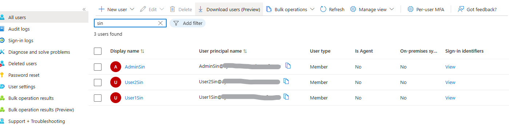
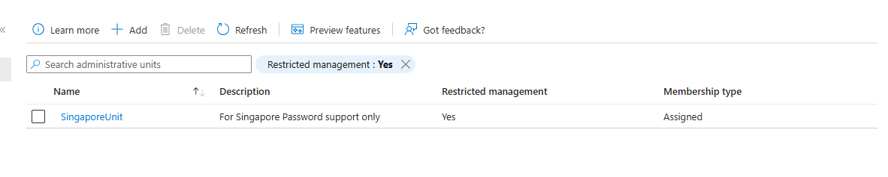
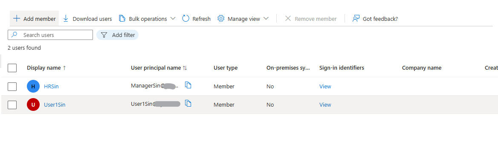
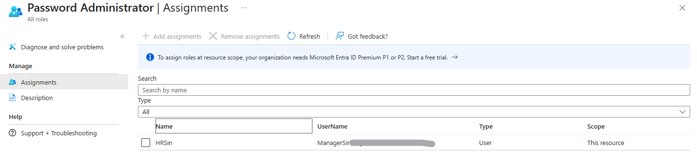

# Microsoft Entra ID – Administrative Units

## 🧩 Overview

This lab demonstrates how to implement delegated administration using Administrative Units in Microsoft Entra ID.

Administrative Units enable organizations to delegate administrative tasks to specific administrators without granting tenant-wide permissions. This approach supports the principle of least privilege by limiting administrative scope to a defined set of users, groups, and devices.

In this lab, an Administrative Unit was created to represent a business department, and scoped administrative roles were assigned to allow management of only the users within that Administrative Unit.

---

# ⚠️ Real-World Risk

Without Administrative Units:

- Helpdesk staff often receive excessive permissions
- Administrators may gain visibility into users they should not manage
- Increased risk of accidental or unauthorized changes
- Reduced compliance with least privilege principles

Administrative Units help organizations:

✅ Delegate administration securely

✅ Reduce administrative attack surface

✅ Support compliance requirements

✅ Enforce role scoping

✅ Improve operational efficiency

---

# 🛠 What I Built

- Created an Administrative Unit named **Finance Department**
- Created cloud-only test users
- Added users to the Administrative Unit
- Assigned a scoped administrative role
- Validated delegated administration
- Tested management capabilities within the assigned scope

---

# 🏗 Environment

### Microsoft Entra ID Components

- Administrative Units
- Microsoft Entra Roles
- Role Assignments
- Cloud Users

### Administrative Role Used

- User Administrator

---

# 📸 Step-by-Step Evidence

| Step | Action | Screenshot |
|--------|---------|---------|
| 1 | Create test users |  |
| 2 | Create Administrative Unit | |
| 3 | Add users to Administrative Unit |  |
| 4 | Verify scoped role Password assignment |  |
| 5 | Test delegated administration | `user-edit-test.png` |
| 6 | Confirm restricted access | `scope-validation.png` |

---

# 1️⃣ User Creation

Created cloud-only test users for the lab environment.

### Example Users

- Finance User 1
- Finance User 2
- Finance Administrator

### Evidence

📸 Screenshot:

`users-created.png`

---

# 2️⃣ Administrative Unit Creation

Created a new Administrative Unit within Microsoft Entra ID.

### Configuration

- Name: Finance Department
- Membership Type: Assigned

### Result

The Administrative Unit was successfully created and made available for role scoping.

### Evidence

📸 Screenshot:

`administrative-unit-created.png`

---

# 3️⃣ Add Members to Administrative Unit

Added test users into the newly created Administrative Unit.

### Users Added

- Finance User 1
- Finance User 2

### Result

Users are now managed within the Administrative Unit scope.

### Evidence

📸 Screenshot:

`au-members.png`

---

# 4️⃣ Scoped Role Assignment

Assigned the User Administrator role to a delegated administrator at the Administrative Unit level.

### Configuration

Role Assigned:

- User Administrator

Scope:

- Finance Department Administrative Unit

### Result

The administrator can only manage users within the assigned Administrative Unit.

### Evidence

📸 Screenshot:

`role-assignment.png`

---

# 5️⃣ Delegated Administration Testing

Tested administrative capabilities using the delegated administrator account.

### Actions Tested

✅ Update user profile information

✅ Reset user password

✅ View Administrative Unit members

✅ Manage users within scope

### Evidence

📸 Screenshot:

`user-edit-test.png`

---

# 6️⃣ Scope Restriction Validation

Attempted administrative actions against users outside the Administrative Unit.

### Expected Result

Access denied.

### Validation

The delegated administrator was unable to manage users outside the assigned Administrative Unit.

This confirms proper role scoping.

### Evidence

📸 Screenshot:

`scope-validation.png`

---

# 🔐 Security Validation

The delegated administrator was able to:

✅ Manage users inside the Administrative Unit

✅ Reset passwords for scoped users

✅ Update selected user attributes

The delegated administrator could NOT:

❌ Manage users outside the Administrative Unit

❌ Assign global roles

❌ Access tenant-wide administration functions

---

# 🧰 Tools & Services Used

- Microsoft Entra ID
- Microsoft Entra Administrative Units
- Microsoft Entra Roles & Administrators
- Microsoft Entra Admin Center
- Microsoft 365 Admin Center

---

# 💡 Outcome

This lab demonstrates how Administrative Units can be used to implement secure delegated administration within Microsoft Entra ID.

By limiting administrative permissions to specific users and departments, organizations can enforce least privilege access, reduce administrative risk, and improve governance of identity resources.

---

# 🧩 Troubleshooting

### Unable to edit users within the Administrative Unit

Verify:

- User is a member of the Administrative Unit
- User Administrator role is assigned at Administrative Unit scope
- Role assignment has propagated

### Can view users but cannot modify them

Verify:

- Appropriate administrative role has been assigned
- Administrative Unit role assignment is active

### Administrative Unit options not visible

Verify:

- Microsoft Entra ID P1 or P2 licensing requirements
- Appropriate administrative permissions

---

# ✅ Lab Result

Successfully implemented Administrative Units and delegated administration in Microsoft Entra ID while maintaining least privilege access and role scoping.
