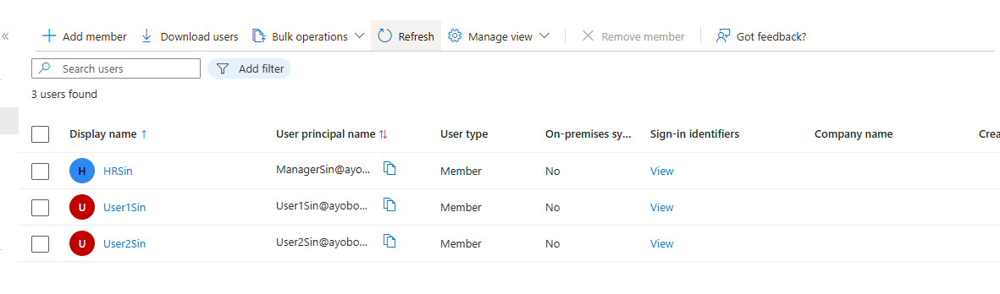
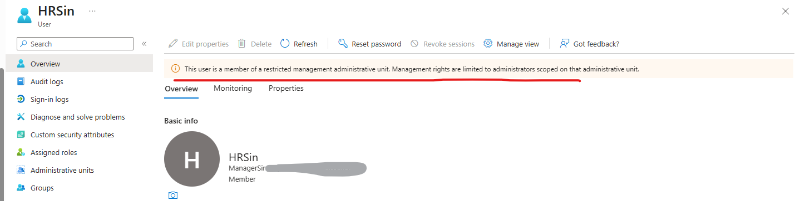

# Microsoft Entra ID – Administrative Units

## 🧩 Overview

This lab demonstrates how to implement delegated administration using Administrative Units in Microsoft Entra ID.

Administrative Units enable organizations to delegate administrative responsibilities to specific administrators without granting tenant-wide permissions. This approach supports the principle of least privilege by restricting administrative scope to a defined set of users, groups, and devices.

In this lab, an Administrative Unit was created to represent a business department. A scoped administrative role was then assigned, allowing password management only for users who belong to that Administrative Unit.

---

# ⚠️ Real-World Risk

Without Administrative Units:

- Helpdesk staff may receive excessive permissions.
- Administrators may gain visibility into users they should not manage.
- There is an increased risk of accidental or unauthorized changes.
- Organizations may struggle to comply with least privilege requirements.

Administrative Units help organizations:

✅ Delegate administration securely

✅ Reduce the administrative attack surface

✅ Support compliance and governance requirements

✅ Enforce role scoping

✅ Improve operational efficiency

---

# 🛠 What I Built

- Created an Administrative Unit named **Finance Department**
- Created cloud-only test users
- Added users to the Administrative Unit
- Assigned a scoped administrative role
- Validated delegated administration
- Tested password management capabilities within the assigned scope

---

# 🏗 Environment

### Microsoft Entra ID Components

- Administrative Units
- Microsoft Entra Roles
- Role Assignments
- Cloud Users

### Administrative Role Used

- Password Administrator

---

# 📸 Step-by-Step Evidence

| Step | Action | Screenshot |
|--------|---------|---------|
| 1 | Create test users |  |
| 2 | Create Administrative Unit | |
| 3 | Add users to Administrative Unit |  |
| 4 | Verify scoped role Password assignment |  |
| 5 | Test delegated administration | `user-edit-test.png` |
| 6 | Confirm restricted access | |

---

# 1️⃣ User Creation

Created cloud-only test users for the lab environment.

### Example Users

- User1Sin
- HrSin

### Evidence

📸 Screenshot:

---

# 2️⃣ Administrative Unit Creation

Created a new Administrative Unit within Microsoft Entra ID.

### Configuration

- Name: Finance Department
- Membership Type: Assigned

### Result

The Administrative Unit was successfully created and made available for delegated administration and role scoping.

### Evidence

📸 Screenshot:

---

# 3️⃣ Add Members to Administrative Unit

Added User2Sin to the newly created Administrative Unit.

### Users Added

- User2Sin

### Result

The user was successfully added to the Administrative Unit and is now managed within its scope.

### Evidence

📸 Screenshot:

---

# 4️⃣ Scoped Role Assignment

Assigned the Password Administrator role to a delegated administrator at the Administrative Unit level.

### Configuration

Role Assigned:

- Password Administrator

Scope:

- Singapore Administrative Unit

### Result

The administrator can reset passwords only for eligible users within the assigned Administrative Unit, without receiving tenant-wide administrative permissions.

### Evidence

📸 Screenshot:

---

# 5️⃣ Delegated Administration Testing

Tested administrative capabilities using the delegated administrator account.

### Actions Tested

✅ Reset user passwords within scope

✅ View Administrative Unit members

✅ Perform password administration for assigned users

### Evidence

📸 Screenshot:

---

# 6️⃣ Scope Restriction Validation

Attempted password administration actions against users outside the Administrative Unit.

### Expected Result

Access denied.

### Validation

The delegated administrator was unable to perform password management actions on users outside the assigned Administrative Unit.

This confirms that role permissions were correctly scoped and that least privilege access was successfully enforced.

### Evidence

📸 Screenshot:

---

# 🔐 Security Validation

The delegated administrator was able to:

✅ View users inside the Administrative Unit

✅ Reset passwords for scoped users

✅ Perform password administration within the assigned scope

The delegated administrator could NOT:

❌ Reset passwords for users outside the Administrative Unit

❌ Assign global administrative roles

❌ Access tenant-wide administration functions

---

# 🧰 Tools & Services Used

- Microsoft Entra ID
- Microsoft Entra Administrative Units
- Microsoft Entra Roles & Administrators
- Microsoft Entra Admin Center
- Microsoft 365 Admin Center

---

# 💡 Outcome

This lab demonstrates how Administrative Units can be used to implement secure delegated administration within Microsoft Entra ID.

By restricting administrative permissions to a specific set of users, organizations can enforce least privilege access, reduce administrative risk, and strengthen identity governance controls.

---

# 🧩 Troubleshooting

### Unable to reset passwords within the Administrative Unit

Verify:

- The user is a member of the Administrative Unit.
- The Password Administrator role is assigned at the Administrative Unit scope.
- The role assignment has fully propagated.

### Can view users but cannot reset passwords

Verify:

- The appropriate administrative role has been assigned.
- The Administrative Unit role assignment is active.
- The target user falls within the Administrative Unit scope.

### Administrative Unit options not visible

Verify:

- Microsoft Entra ID licensing requirements are met.
- Appropriate administrative permissions are assigned.
- Administrative Units are available within the current tenant configuration.

---

# ✅ Lab Result

Successfully implemented Administrative Units and delegated password administration in Microsoft Entra ID while maintaining least privilege access and scoped administrative control.
