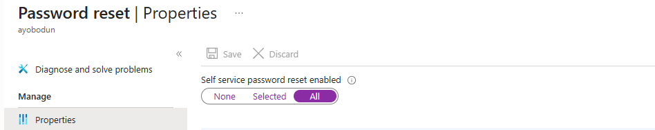
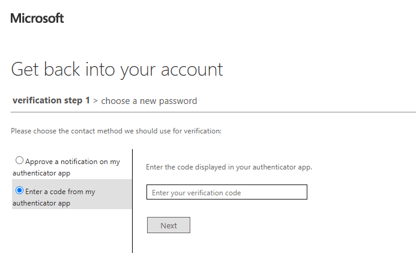
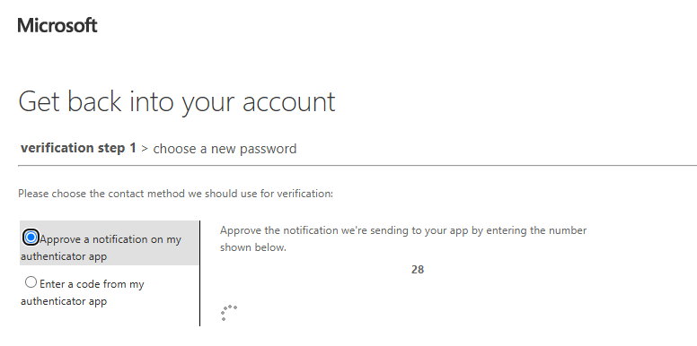
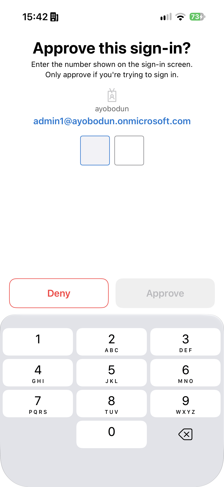
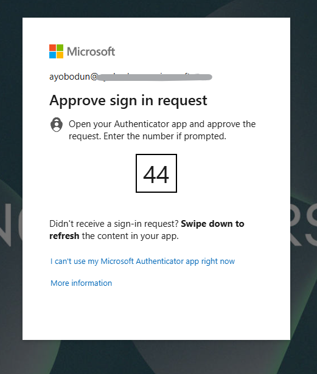

# Microsoft Entra ID – Self-Service Password Reset (SSPR)

## 🧩 Overview

This lab demonstrates how to configure and validate Self-Service Password Reset (SSPR) in Microsoft Entra ID.

Self-Service Password Reset (SSPR) allows users to securely reset their passwords without contacting the IT helpdesk. This reduces support overhead, improves user productivity, and strengthens identity security by enabling secure account recovery.

In this lab, SSPR was enabled for users, authentication methods were configured, and the password reset process was validated using Microsoft Authenticator with number matching.

---

# ⚠️ Real-World Risk

Without Self-Service Password Reset:

- Users rely on IT support for password resets.
- Password-related incidents increase helpdesk workload.
- Users experience delays regaining access to their accounts.
- Productivity can be impacted due to account lockouts.

SSPR helps organizations:

✅ Reduce helpdesk workload

✅ Improve user productivity

✅ Enable secure account recovery

✅ Strengthen identity security

✅ Support Zero Trust principles

---

# 🛠 What I Built

- Enabled Self-Service Password Reset (SSPR)
- Configured password reset policies
- Registered authentication methods
- Configured Microsoft Authenticator verification
- Tested the complete password reset workflow
- Validated secure account recovery using number matching

---

# 🏗 Environment

### Microsoft Entra ID Components

- Self-Service Password Reset (SSPR)
- Authentication Methods
- Microsoft Authenticator
- Password Reset Portal

### Authentication Method Used

- Microsoft Authenticator

---

## 📸 Step-by-Step Evidence

| Step | Action | Screenshot |
|------|--------|------------|
| 1 | Enable Self-Service Password Reset |  |
| 2 | Start Password Reset Process |  |
| 3 | Select Authentication Method |  |
| 4 | Number Matching Challenge Generated |  |
| 5 | Microsoft Authenticator Verification |  |
| 6 | Authentication Approval Request |  |

# 1️⃣ Enable Self-Service Password Reset

Enabled Self-Service Password Reset within Microsoft Entra ID.

### Configuration

- Self-Service Password Reset: Enabled
- Scope: All Users

### Result

Users can securely reset their passwords without requiring helpdesk assistance.

### Evidence

📸 Screenshot:

---

# 2️⃣ Start Password Reset Process

Initiated the password reset process using the Microsoft password reset portal.

### Steps Performed

1. Navigated to the password reset portal.
2. Entered the username.
3. Started the account recovery process.

### Result

The password reset workflow was successfully initiated.

### Evidence

📸 Screenshot:

---

# 3️⃣ Select Authentication Method

Configured Microsoft Authenticator as the verification method during the password reset process.

### Result

The user was prompted to verify their identity using Microsoft Authenticator.

### Evidence

📸 Screenshot:

---

# 4️⃣ Number Matching Challenge Generated

Microsoft Entra ID generated a number matching challenge to verify the user's identity securely.

### Result

The user was prompted to approve the request using the number displayed on the sign-in screen.

### Evidence

📸 Screenshot:

---

# 5️⃣ Microsoft Authenticator Verification

The number matching challenge was sent to Microsoft Authenticator.

### Result

The user entered the correct number within Microsoft Authenticator to verify possession of the registered device.

### Evidence

📸 Screenshot:

---

# 6️⃣ Authentication Approval Request

Microsoft Authenticator generated an approval request as part of the password reset process.

### Result

The authentication challenge was successfully delivered to the registered device.

### Evidence

📸 Screenshot:

---

# 🔐 Security Validation

The user was able to:

✅ Initiate the password reset process

✅ Verify identity using Microsoft Authenticator

✅ Complete number matching verification

✅ Recover account access securely

The user could NOT:

❌ Reset the password without identity verification

❌ Bypass Microsoft Authenticator verification

❌ Complete the reset process without access to the registered authentication method

---

# 🧰 Tools & Services Used

- Microsoft Entra ID
- Self-Service Password Reset (SSPR)
- Microsoft Authenticator
- Microsoft Entra Admin Center
- Microsoft 365 Admin Center

---

# 💡 Outcome

This lab demonstrates how Self-Service Password Reset can improve security while reducing operational overhead.

By enabling secure self-service account recovery with Microsoft Authenticator and number matching, organizations can reduce password-related support requests while maintaining strong identity verification controls.

---

# 🧩 Troubleshooting

### Unable to reset password

Verify:

- SSPR is enabled for the user.
- The user is licensed appropriately.
- Security information has been registered.

### Authentication method unavailable

Verify:

- Microsoft Authenticator is installed.
- The Authenticator app is registered to the user's account.
- Internet connectivity is available.

### Number matching approval not received

Verify:

- Push notifications are enabled on the mobile device.
- Microsoft Authenticator is configured correctly.
- The device is connected to the internet.

---

# ✅ Lab Result

Successfully configured and tested Self-Service Password Reset (SSPR) in Microsoft Entra ID, validating secure account recovery using Microsoft Authenticator and number matching verification.
