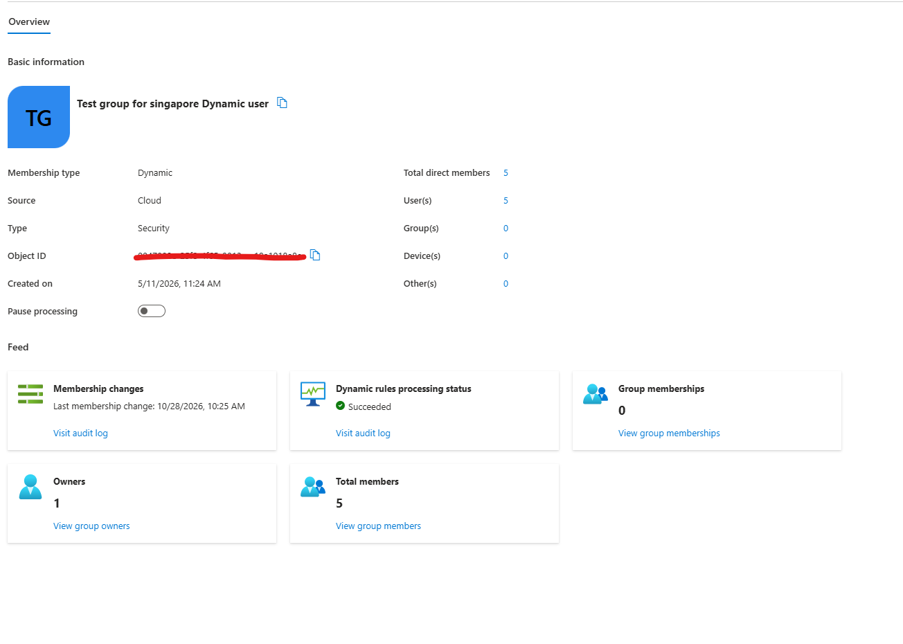
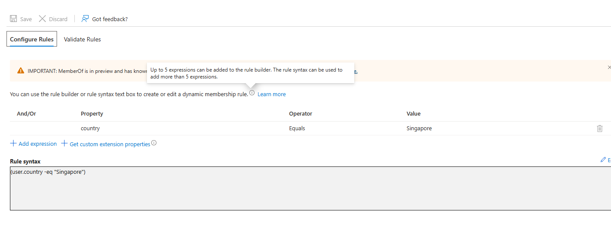
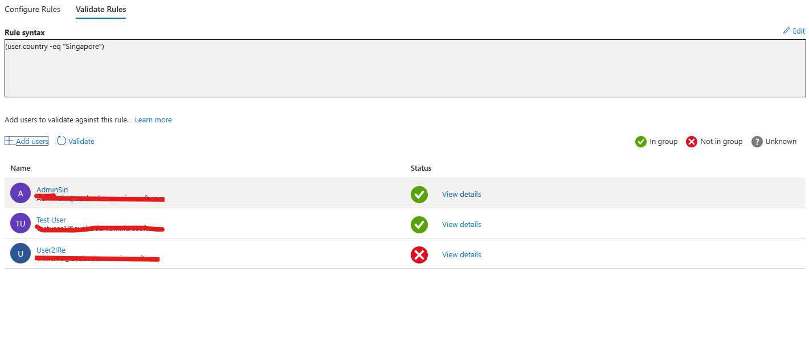
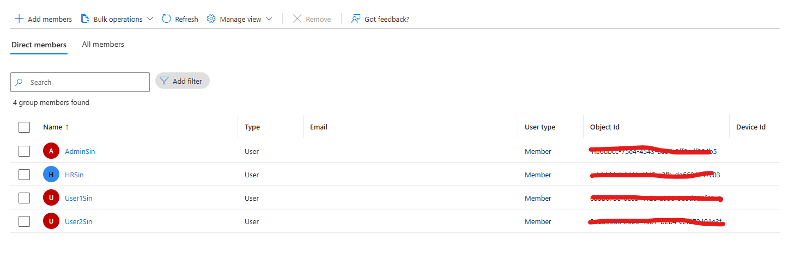

# Microsoft Entra ID – Dynamic Groups

## 🧩 Overview

This lab demonstrates how to implement Dynamic Groups in Microsoft Entra ID.

Dynamic Groups automatically manage group memberships based on user or device attributes, reducing the need for manual administration.

In this lab, I configured a Dynamic Security Group using a membership rule based on the user's country attribute. The rule identifies users whose country is set to Singapore and automatically manages their group membership.

This lab covers group creation, membership rule configuration, rule validation, membership verification, and the impact of changes to user attributes.

---

## ⚠️ Real-World Risk

Without Dynamic Groups:

- User onboarding requires manual group assignments.
- Users may retain inappropriate or outdated group memberships.
- Administrative overhead increases.
- Group membership becomes harder to maintain.
- Inconsistent group assignments can lead to access management issues.

Dynamic Groups help organisations:

- ✅ Automate group membership management.
- ✅ Reduce administrative workload.
- ✅ Improve consistency in access assignment.
- ✅ Support identity lifecycle management.
- ✅ Reduce errors caused by manual administration.

**Security consideration:** Dynamic Groups automate membership, but they do not grant access permissions by themselves. Access must be assigned separately where required.

---

## 🛠 What I Built

- Created a Dynamic Security Group.
- Configured a dynamic membership rule.
- Used the `Country` attribute to determine group membership.
- Validated the membership rule.
- Verified automatic group membership.
- Tested membership changes following user attribute updates.
- Documented the group configuration in JSON.

---

## 🏗 Environment

### Microsoft Entra ID Components

- Microsoft Entra ID
- Dynamic Groups
- Dynamic Membership Rules
- User Attributes
- Security Groups

### Group Configuration

| Setting | Value |
|---|---|
| Group Type | Security |
| Membership Type | Dynamic User |
| Membership Attribute | Country |
| Operator | Equals |
| Attribute Value | Singapore |

### Example Test Users

- User1Sin
- User2Sin
- HrSin

These test accounts represent users whose country attribute is configured to match the membership rule.

---

## 📸 Step-by-Step Screenshots

The following screenshots document the group creation, configuration, and validation process.

### 1. Dynamic Groups Dashboard

This screenshot shows the Dynamic Groups area in Microsoft Entra ID.

### 2. Dynamic Security Group Created

This screenshot documents the creation of the Dynamic Security Group.

### 3. Dynamic Membership Rule

This screenshot shows the membership rule configured for the group.

**Membership rule:**

`(user.country -eq "Singapore")`

### 4. Dynamic Rule Validation

This screenshot documents the membership rule validation process.

### 5. Dynamic Group Members

This screenshot shows the group membership results after Microsoft Entra ID evaluates the configured rule.

---

## ⚙️ Membership Rule Configuration

The membership rule used in this lab is:

`(user.country -eq "Singapore")`

### How It Works

- `user.country` identifies the user's country attribute.
- `-eq` checks whether the attribute equals the specified value.
- `"Singapore"` is the value users must match to satisfy the rule.

Microsoft Entra ID evaluates the rule and updates group membership according to users' attributes.

Users who match the rule become members of the group. Users who no longer match can be removed after dynamic membership processing completes.

### Configuration File

The configuration is documented in:

`Config/dynamic-membership-rule.json`

This file records the intended group configuration and membership rule for documentation and reference.

---

## 🔐 Security Validation

The lab focuses on the following checks:

- ✅ Dynamic membership rule configured using the country attribute.
- ✅ Membership rule syntax validated.
- ✅ Eligible users checked against the rule.
- ✅ Group membership reviewed.
- ✅ Attribute changes considered during membership testing.

Dynamic membership processing may take time. Changes to user attributes do not necessarily result in immediate membership updates.

The validation results should reflect what was actually observed in the test environment.

---

## 🧰 Tools & Services Used

- Microsoft Entra ID
- Microsoft Entra Admin Center
- Dynamic Security Groups
- Dynamic Membership Rules
- JSON
- GitHub

---

## 💡 Outcome

This lab demonstrates how Dynamic Groups can simplify identity administration by automatically managing group membership according to user attributes.

Using attribute-based membership rules can reduce manual administration, improve consistency, and support scalable identity management.

The lab reinforces my understanding of dynamic membership rules, user attributes, and automated identity lifecycle management in Microsoft Entra ID.

---

## 🧩 Troubleshooting

### User Not Added to Group

Verify:

- The user's country attribute matches the membership rule.
- The membership rule is configured correctly.
- Dynamic membership processing has completed.
- The user satisfies the rule's conditions.

### Membership Rule Error

Verify:

- The rule syntax is correct.
- Supported attributes and operators are used.
- Quotation marks and parentheses are correct.
- The membership rule validation feature reports no errors.

### Group Membership Not Updating

Verify:

- Dynamic membership processing has completed.
- The user's attributes have been updated correctly.
- The group is configured for dynamic user membership.
- The user still satisfies the membership rule.

---

## ✅ Lab Result

Implemented and documented a Dynamic Security Group configuration in Microsoft Entra ID using a country-based membership rule.

The lab demonstrates how attribute-based membership rules can automate group membership management and reduce reliance on manual administration.

Screenshots and the JSON configuration file provide supporting documentation for the lab.
