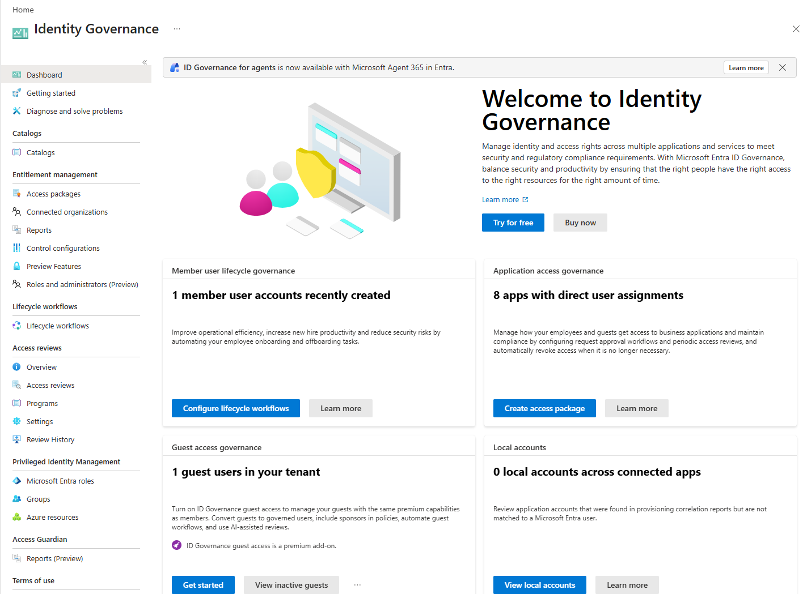
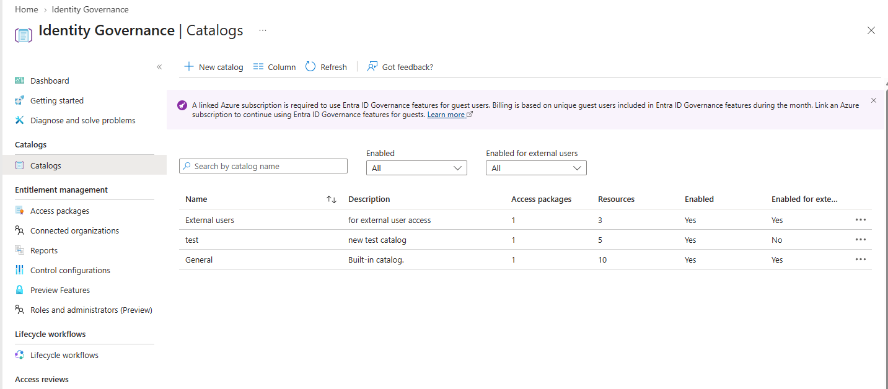
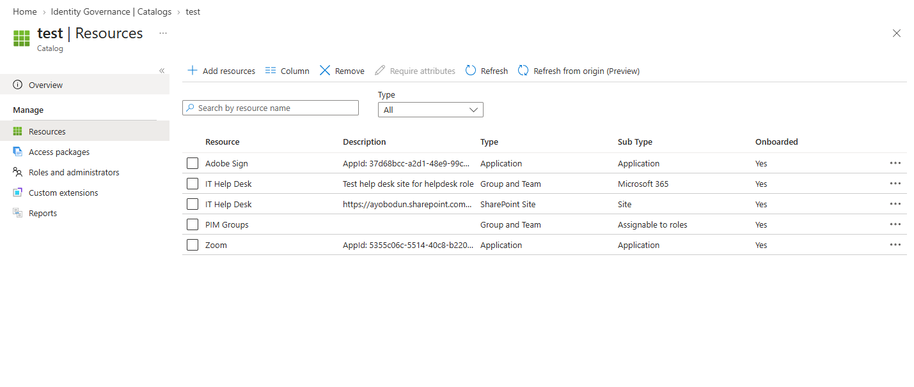
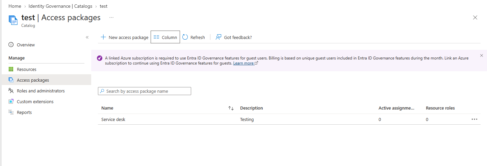
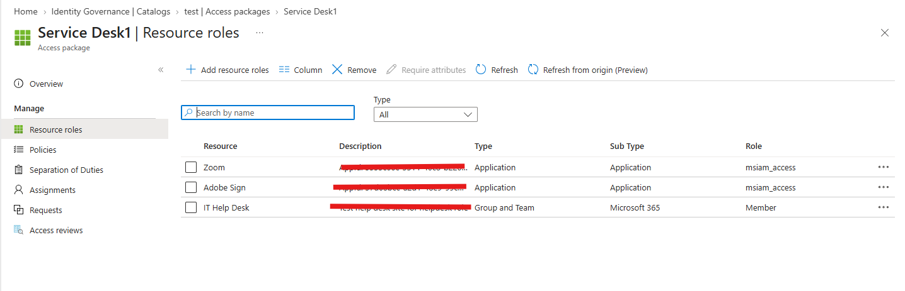
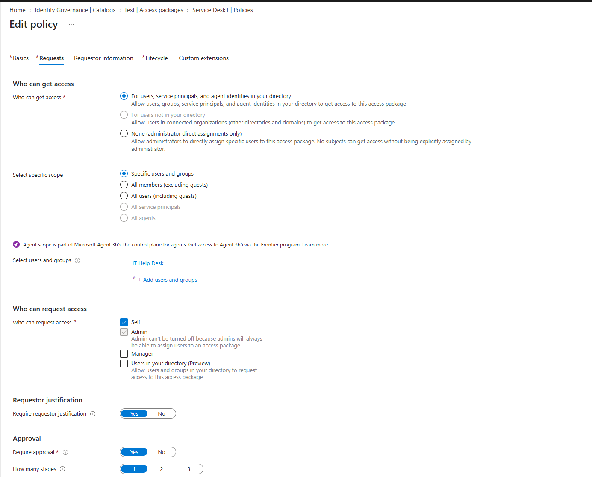
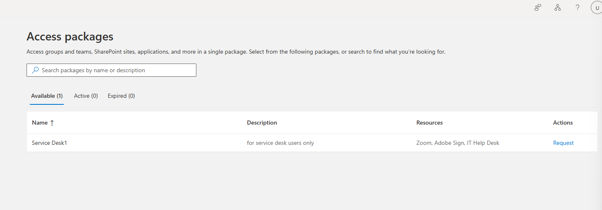
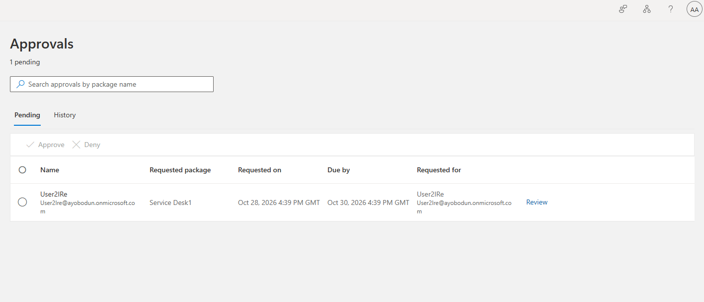
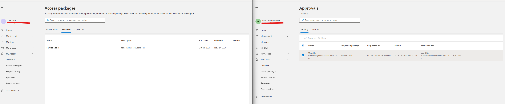

# Microsoft Entra ID – Entitlement Management & Access Packages

## 🧩 Overview

This lab demonstrates how to configure Entitlement Management in Microsoft Entra ID to manage user access to organizational resources through access packages.

Entitlement Management enables organizations to manage the access lifecycle by allowing users to request resources through controlled policies. Access packages can bundle resources such as groups, applications, and SharePoint sites, simplifying access provisioning and governance.

In this lab, I created an access package catalog, added resources, configured an access package and access policy, and tested the access request and approval workflow.

The lab demonstrates how Microsoft Entra ID can support structured access provisioning, approval workflows, and identity governance.

---

## ⚠️ Real-World Risk

Without proper identity governance:

- Users may retain access to resources they no longer need.
- Access requests may be handled manually and inconsistently.
- Employees may receive excessive permissions.
- Onboarding and offboarding can become difficult to manage.
- Organizations may lack visibility into who has access to specific resources.

Microsoft Entra Entitlement Management helps organizations:

- ✅ Centralize access request management.
- ✅ Apply approval workflows to access requests.
- ✅ Standardize resource provisioning.
- ✅ Manage access assignments and expiration.
- ✅ Improve identity governance and compliance.
- ✅ Support the principle of least privilege.

---

## 🛠 What I Built

- Created an access package catalog.
- Added resources to the catalog.
- Created an access package.
- Configured resources and resource roles.
- Created an access policy.
- Configured request and approval settings.
- Submitted a test access request.
- Reviewed the pending approval.
- Approved the access request.
- Verified the resulting access package assignment.

---

## 🏗 Environment

### Microsoft Entra ID Components

- Microsoft Entra ID
- Microsoft Entra Entitlement Management
- Access Package Catalogs
- Access Packages
- Resource Roles
- Access Policies
- Access Requests and Approvals
- Access Package Assignments

### Access Governance

- Request-based access provisioning
- Approval workflows
- Resource role assignment
- Assignment lifecycle management

---

## 📸 Step-by-Step Screenshots

The following screenshots document the configuration, access request, approval, and assignment workflow.

### 1. Entitlement Management Overview

This screenshot shows the Microsoft Entra Entitlement Management interface used to manage access packages and identity governance.

### 2. Access Package Catalog Creation

Created an access package catalog to organize resources that can be made available through access packages.

The catalog provides a central location for managing resources used in access packages.

### 3. Adding Resources to the Catalog

Added resources to the access package catalog so they could be selected when configuring an access package.

Resources can include supported groups, applications, and SharePoint sites.

### 4. Access Package Creation

Created an access package within the catalog to group resources into a single package for controlled access provisioning.

### 5. Access Package Resource Configuration

Configured the resources and associated resource roles included in the access package.

Resource roles determine the level of access users receive when the package is assigned.

### 6. Access Policy Configuration

Configured an access policy to define who could request the access package and how requests would be handled.

Depending on the policy configuration, access policies can specify eligible requestors, approval requirements, approvers, and assignment duration.

### 7. Requesting Access to the Package

Tested the access request workflow by requesting access to the configured access package.

This demonstrates how users can request access through a defined process rather than relying entirely on manual access assignments.

### 8. Pending Approval

Reviewed the access request while it was awaiting approval.

Approval workflows allow designated approvers to review requests before access is granted.

### 9. Access Request Approved

Verified that the access request was approved through the configured approval workflow.

Approval allows the request to proceed through the access package assignment process.

### 10. Access Assignment Created

Verified the resulting access package assignment after the request was approved.

This demonstrates how Entitlement Management can provision the resources and roles associated with an access package through a controlled assignment workflow.

---

## ⚙️ How Entitlement Management Works

Microsoft Entra Entitlement Management uses several components to control access to organizational resources.

### Access Package Catalog

The catalog organizes resources that can be included in access packages.

### Access Package

The access package groups resources and their associated roles into a package that can be assigned to eligible users.

### Access Policy

The access policy defines who can request the package and the conditions under which access is granted.

Depending on the configuration, this may include approval requirements, assignment duration, and expiration settings.

### Access Request

An eligible user requests access to the package through the available request workflow.

### Approval Workflow

If approval is required, the request is reviewed by the configured approver before it proceeds.

### Access Assignment

After the request is approved and provisioning completes, the user receives an assignment to the access package and its configured resources.

---

## 🔐 Security Validation

The lab focuses on the following security and governance checks:

- ✅ Access package catalog created.
- ✅ Resources added to the catalog.
- ✅ Access package configured with the intended resources.
- ✅ Resource roles reviewed.
- ✅ Access policy configured.
- ✅ Access request submitted.
- ✅ Approval workflow tested.
- ✅ Approved request reviewed.
- ✅ Resulting access assignment verified.

### Security Considerations

Entitlement Management can help organizations reduce the risk of:

- ❌ Inconsistent manual access provisioning.
- ❌ Uncontrolled access requests.
- ❌ Excessive resource permissions.
- ❌ Users retaining access beyond their requirements.
- ❌ Poor visibility into access assignments.

**Security note:** These benefits depend on the access package, resource roles, policies, and lifecycle settings configured. Creating an access package alone does not guarantee that unauthorized access is prevented.

---

## 🧰 Tools & Services Used

- Microsoft Entra ID
- Microsoft Entra Admin Center
- Microsoft Entra Entitlement Management
- Access Package Catalogs
- Access Packages
- Access Policies
- Access Requests and Approvals
- Access Package Assignments
- GitHub

---

## 💡 Outcome

This lab demonstrates how Microsoft Entra Entitlement Management can simplify identity governance by grouping resources into access packages and applying policies to control how users request and receive access.

By using access packages, organizations can establish a consistent process for resource provisioning, approval workflows, and assignment management.

The lab provided practical experience with the access lifecycle, from catalog creation and resource configuration through access requests, approval, and assignment verification.

This approach supports the principle of least privilege by helping organizations grant users access according to defined policies and organizational requirements.

---

## 🧩 Troubleshooting

### Resources Not Appearing in the Catalog

Verify:

- The correct catalog has been selected.
- The resource type is supported.
- The resource is available in the tenant.
- The account has the required permissions.
- The resource has been added to the catalog before configuring the access package.

### Users Cannot Request an Access Package

Verify:

- An applicable access policy exists.
- The user meets the policy's requestor requirements.
- The access package and policy are configured correctly.
- The user is using the appropriate access request portal.
- The required licensing and permissions are available.

### Access Request Is Not Approved

Verify:

- Whether approval is required by the policy.
- The configured approver settings.
- Whether the request is awaiting approval.
- Whether the approver can access and process the request.
- Whether the request has been rejected or requires further action.

### User Does Not Receive the Expected Access

Verify:

- The access package assignment status.
- The resources included in the package.
- The selected resource roles.
- Whether the request has been approved.
- Whether provisioning has completed.
- Whether additional permissions are required on the target resource.

### Access Package Assignment Is Not Created

Verify:

- The request has reached the appropriate approval state.
- The access package policy is configured correctly.
- The requested resources are available.
- The assignment and provisioning status.
- Whether any errors are reported in the access package assignment details.

### Approval Settings Are Incorrect

Verify:

- The correct policy has been selected.
- Approval is enabled if required.
- The intended approver or approval stage is configured.
- The policy applies to the intended requestors.
- The access package has the expected assignment settings.

---

## ✅ Lab Result

Successfully configured an access package catalog and explored how Microsoft Entra Entitlement Management manages access through access packages and policies.

The lab demonstrates the following workflow:

1. Create an access package catalog.
2. Add resources to the catalog.
3. Create an access package.
4. Configure package resources and roles.
5. Configure an access policy.
6. Submit an access request.
7. Review the pending approval.
8. Approve the request.
9. Verify the resulting access assignment.

This project demonstrates practical knowledge of Microsoft Entra Entitlement Management, access governance, approval workflows, and access package provisioning.
