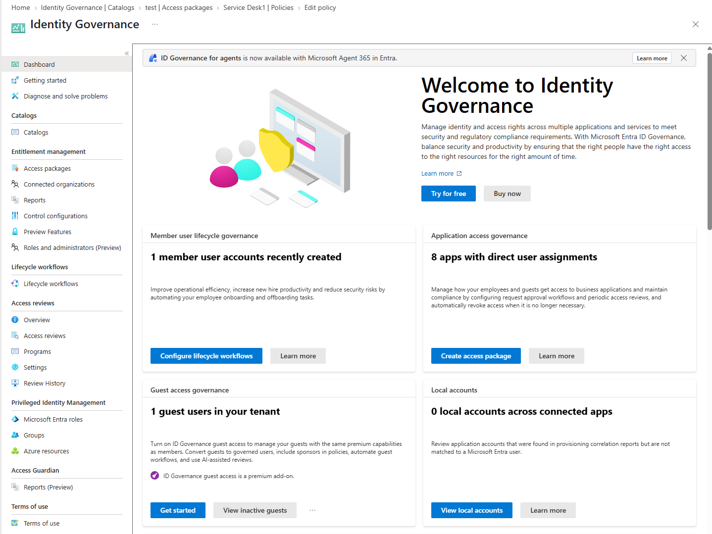
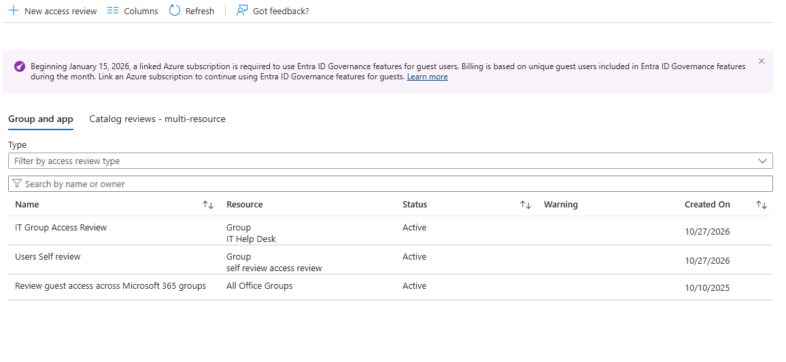
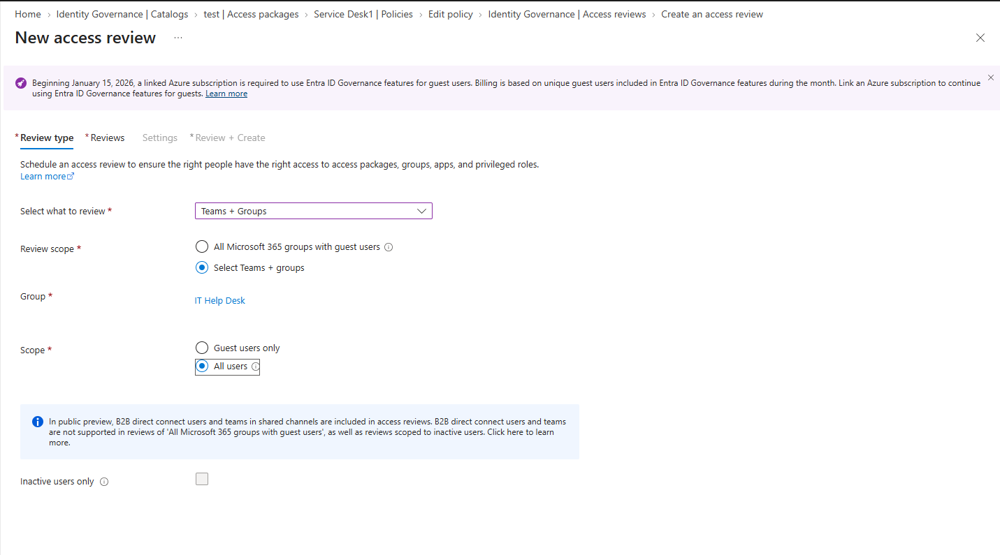
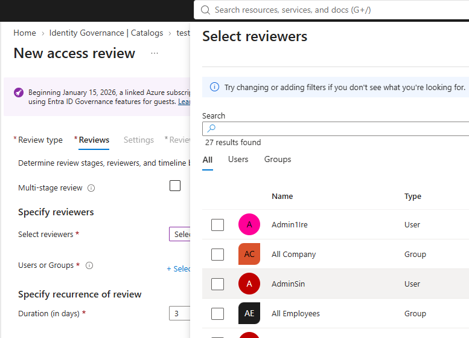
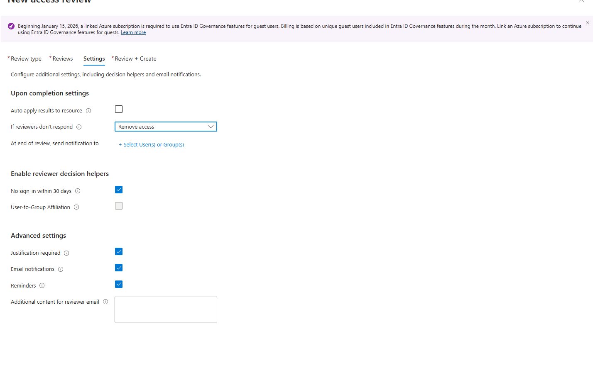
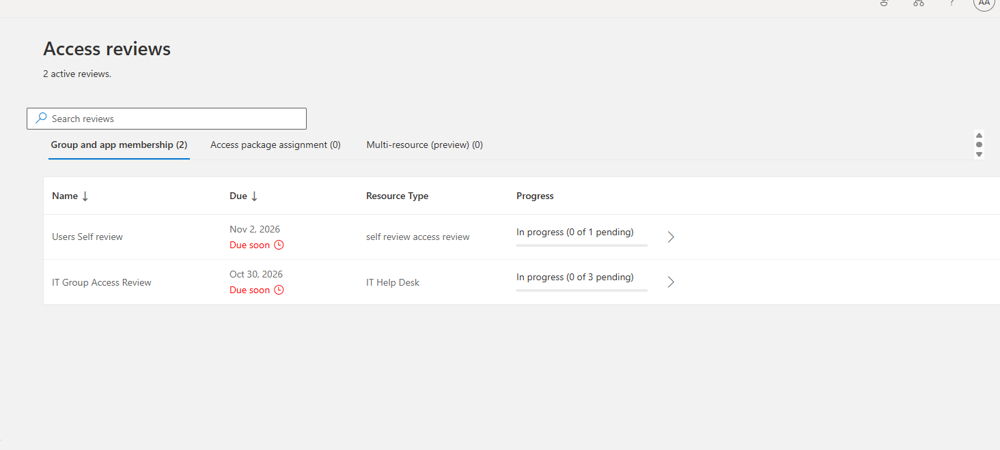
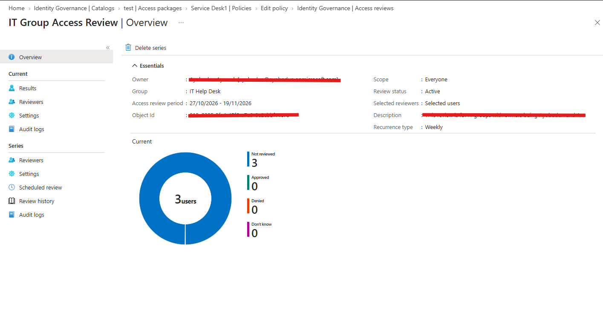

# Microsoft Entra ID – Access Reviews & Identity Governance

## 🧩 Overview

This lab demonstrates how to configure Access Reviews in Microsoft Entra ID to periodically review user access to organizational resources.

Access Reviews enable organizations to verify whether users should retain access to groups, enterprise applications, and other supported resources. They help ensure that access remains appropriate as employees change roles, leave the organization, or no longer require specific permissions.

In this lab, an access review is configured to evaluate user access, collect review decisions, and demonstrate how organizations can maintain appropriate access through recurring reviews.

---

## ⚠️ Real-World Risk

Without regular access reviews:

- Former employees may retain access to organizational resources.
- Users may accumulate unnecessary permissions over time.
- Guest users may retain access after collaboration ends.
- Group memberships may become outdated.
- Organizations may struggle to demonstrate access governance and compliance.

Microsoft Entra Access Reviews help organizations:

- ✅ Identify unnecessary access.
- ✅ Review guest user access.
- ✅ Validate group memberships.
- ✅ Support least-privilege access.
- ✅ Improve identity governance and compliance.

---

## 🛠 What I Built

- Configured an Access Review.
- Selected the resource and users to review.
- Configured reviewers.
- Defined review settings.
- Started or scheduled the review.
- Evaluated review decisions.
- Reviewed the resulting access review status.

---

## 🏗 Environment

### Microsoft Entra ID Components

- Microsoft Entra ID
- Microsoft Entra ID Governance
- Access Reviews
- Groups and Group Memberships
- Enterprise Applications, where applicable
- Guest User Identities, where applicable

### Access Review Configuration

- Review scope
- Reviewers
- Review frequency and duration
- Review decisions
- Review completion settings

---

## 📸 Step-by-Step Evidence

| Step | Action |
|---|---|
| 1 | Open Access Reviews |
| 2 | Create an Access Review |
| 3 | Configure the Review Scope |
| 4 | Configure Reviewers |
| 5 | Configure Review Settings |
| 6 | Complete the Access Review |
| 7 | Validate Review Results |

---

## 1️⃣ Access Reviews Configuration

Opened Access Reviews within the Microsoft Entra admin centre.

Access Reviews provide a mechanism for periodically evaluating whether users should retain access to organizational resources.

### Result

The Access Reviews area provides the configuration options needed to create and manage access review processes.

### Evidence

---

## 2️⃣ Access Review Creation

Created an access review and selected the resource or membership type to be reviewed.

Depending on the configuration, access reviews can target supported groups, applications, or other eligible access scenarios.

### Result

The access review defines the access that requires evaluation.

### Evidence

---

## 3️⃣ Review Scope Configuration

Configured the scope of the access review by selecting the relevant resource and users.

The review scope determines which memberships or access assignments are included in the review.

### Result

The review is configured to evaluate the selected users' access to the specified resource.

### Evidence

---

## 4️⃣ Reviewer Configuration

Configured the reviewer responsible for evaluating whether users should retain their access.

Depending on the review scenario, reviewers may include resource owners, selected users, or other supported reviewer options.

### Result

The review process identifies who is responsible for making access decisions.

### Evidence

---

## 5️⃣ Access Review Settings

Configured the review settings according to the intended governance requirements.

Depending on the available options, settings may include:

- Review frequency.
- Review duration.
- Review start and end dates.
- Decisions required from reviewers.
- Behaviour when reviewers do not respond.
- Whether completed review decisions are automatically applied.

### Result

The review settings define how the review operates and how its decisions are handled.

### Evidence

---

## 6️⃣ Access Review Decision

Reviewed the access review entries and evaluated whether the selected users should retain access.

Reviewers can make decisions based on whether users still require the resource for their responsibilities.

### Result

The review records decisions about whether access should be retained or removed.

### Evidence

---

## 7️⃣ Review Results and Validation

Reviewed the access review results to verify the status of the review and its decisions.

Where configured and supported, review results can be applied to update access assignments.

### Validation

- Confirmed the review status.
- Checked the decisions submitted by reviewers.
- Reviewed any recommendations or unresolved entries.
- Verified whether decisions had been applied.
- Checked the resulting access assignment where applicable.

### Result

The review provides visibility into access decisions and helps administrators determine whether further action is required.

### Evidence

---

## 🔐 Security Validation

Access Reviews support:

- ✅ Periodic evaluation of user access.
- ✅ Identification of unnecessary permissions.
- ✅ Review of guest user access.
- ✅ Better visibility into group memberships.
- ✅ Documented access decisions.
- ✅ Access removal when negative decisions are applied.

Access Reviews can help reduce the risk of:

- ❌ Stale access assignments.
- ❌ Former users retaining unnecessary access.
- ❌ Excessive group memberships.
- ❌ Unreviewed guest access.
- ❌ Poor visibility into access governance.

**Security note:** Creating an access review does not automatically remove access. The outcome depends on reviewer decisions, review settings, permissions, licensing, and whether the resulting decisions are successfully applied.

---

## 🧰 Tools & Services Used

- Microsoft Entra ID
- Microsoft Entra ID Governance
- Access Reviews
- Microsoft Entra Admin Center
- Groups and Memberships

---

## 💡 Outcome

This lab demonstrates how Microsoft Entra Access Reviews can help organizations maintain appropriate access to organizational resources.

By periodically reviewing group memberships, application access, and guest identities in supported scenarios, organizations can identify unnecessary permissions and take action to improve identity governance.

Access Reviews support the principle of least privilege by helping ensure that users retain access only when it remains appropriate for their responsibilities.

---

## 🧩 Troubleshooting

### Unable to Create an Access Review

Verify:

- The selected resource supports Access Reviews.
- The account has the required administrative permissions.
- The appropriate Microsoft Entra licensing is available.
- The correct review scenario has been selected.

### Users or Groups Are Not Appearing

Verify:

- The correct resource has been selected.
- The review scope supports the intended users or memberships.
- The users belong to the selected resource.
- The account has sufficient permissions to view the resource.

### Reviewer Cannot Submit a Decision

Verify:

- The correct reviewer has been assigned.
- The review is active.
- The reviewer has opened the correct review.
- The review has not expired or been completed.

### Access Was Not Removed After a Review

Verify:

- The reviewer submitted a decision to deny access.
- The review has completed.
- The review settings allow decisions to be applied as intended.
- Automatic application of results is configured where required.
- The resulting assignment and review status have been checked.

---

## ✅ Lab Result

Configured an Access Review in Microsoft Entra ID to evaluate user access to organizational resources.

The lab demonstrates how Access Reviews can support periodic access validation, informed access decisions, and identity governance by helping organizations identify and address unnecessary permissions.
