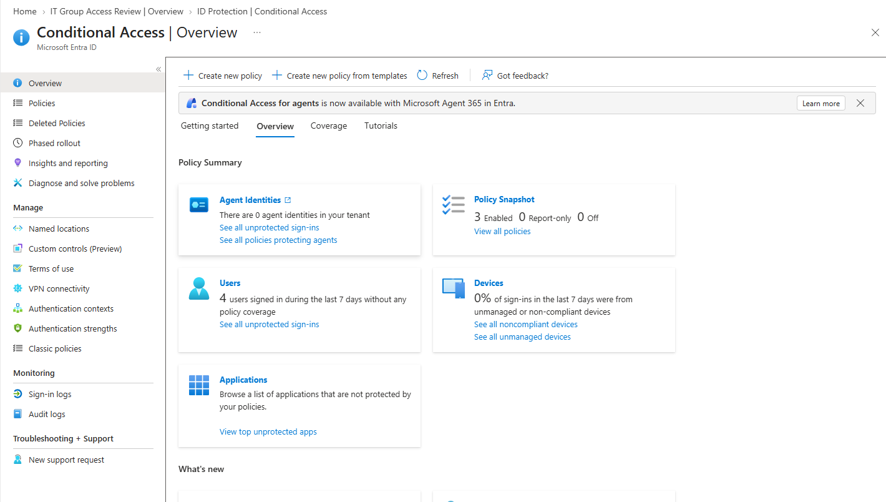
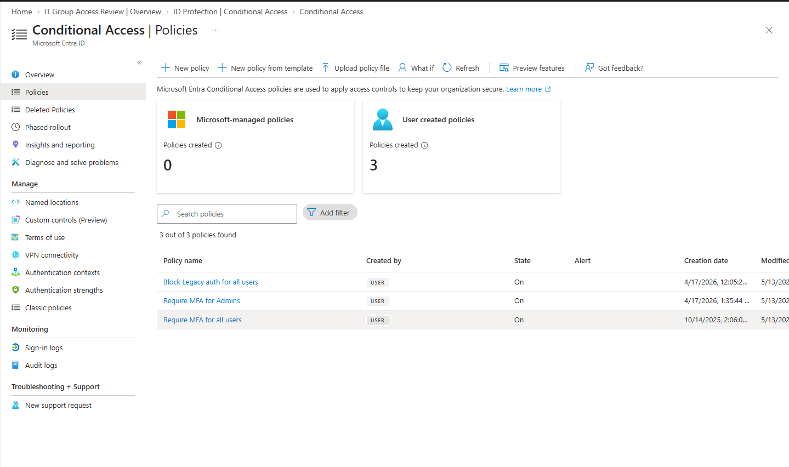
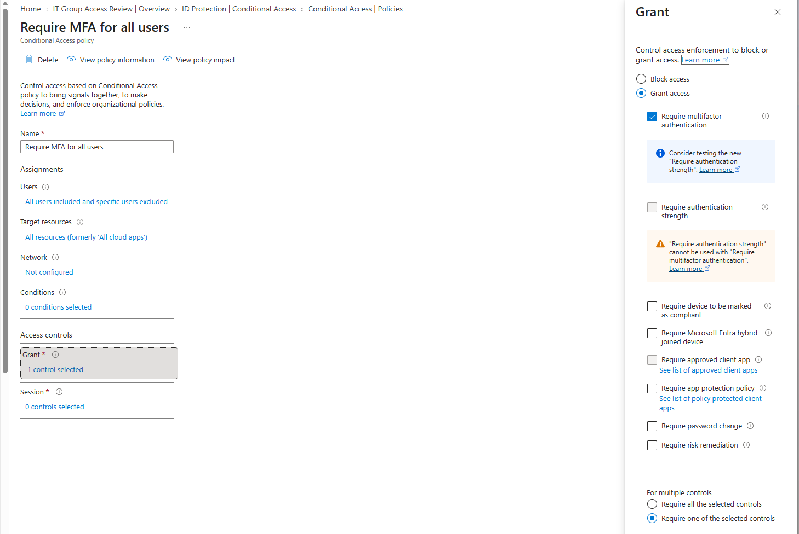
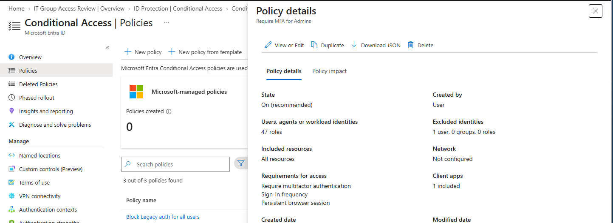
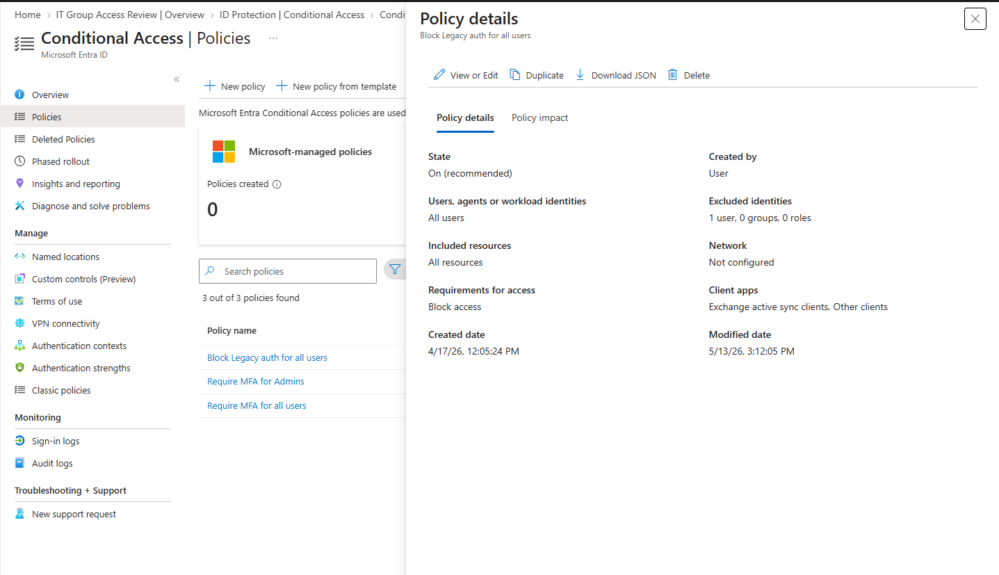
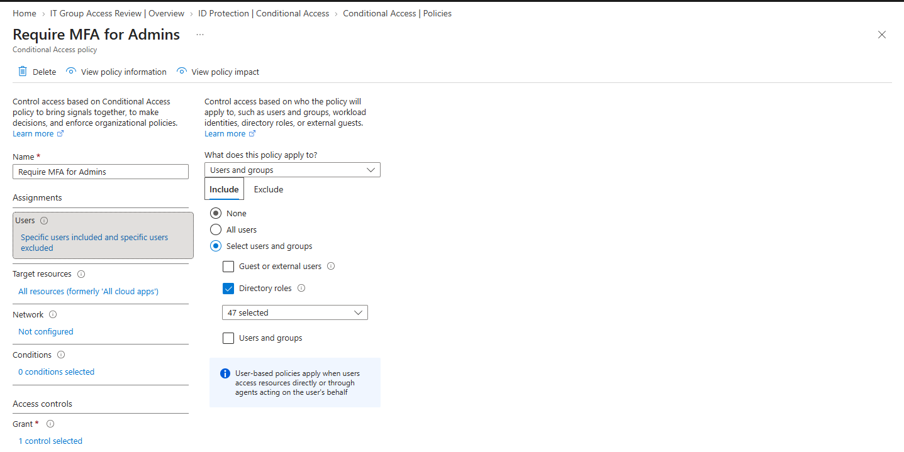
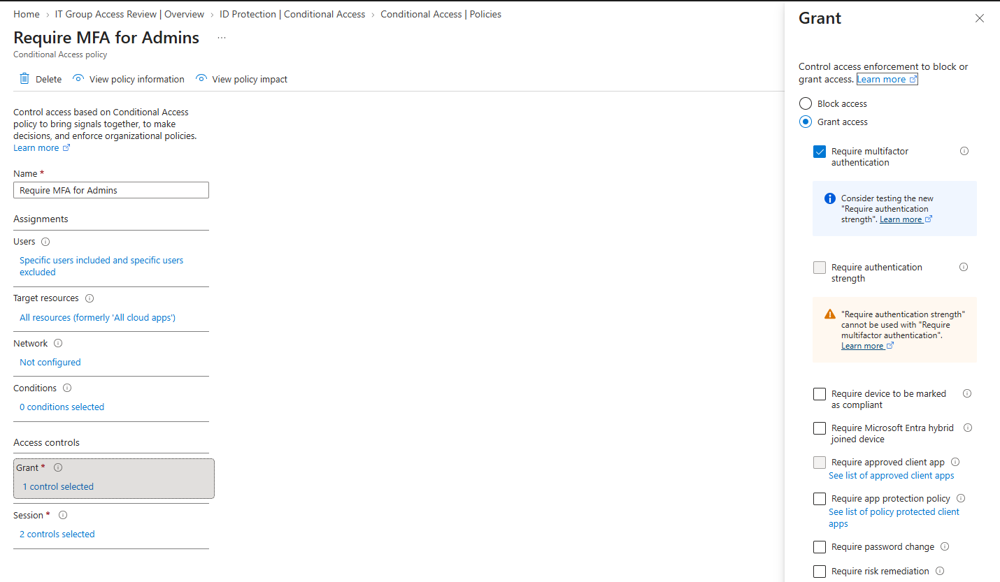
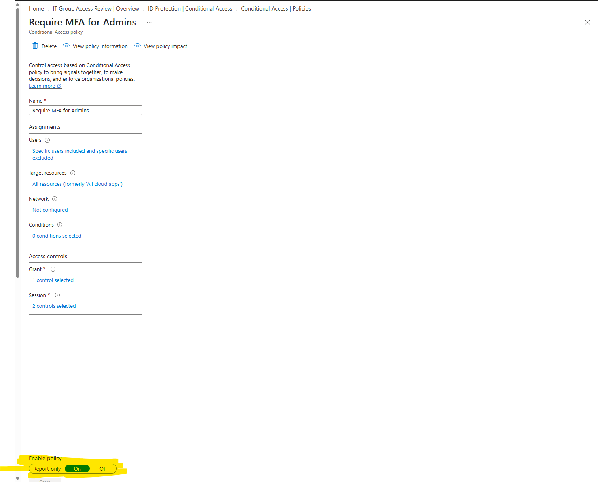
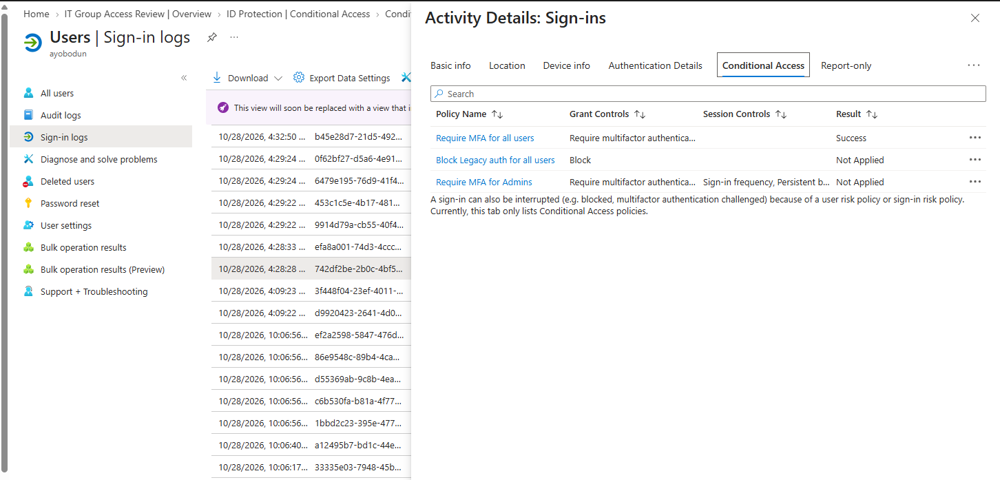
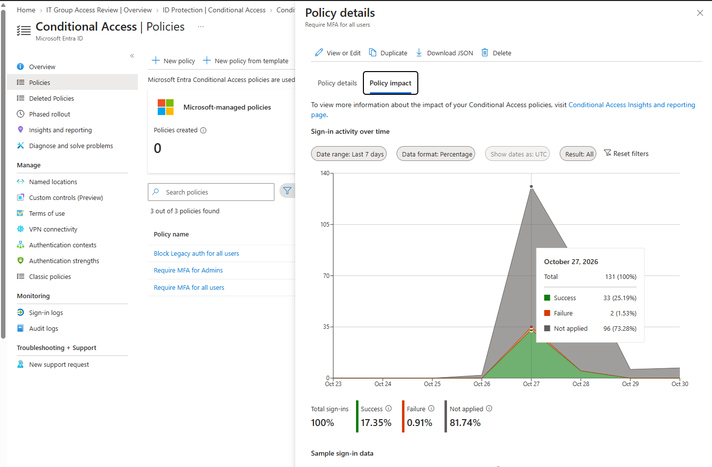

# Microsoft Entra ID – Conditional Access

## 🧩 Overview

This lab demonstrates how to review and validate Conditional Access policies within Microsoft Entra ID.

Conditional Access is a key component of Microsoft Entra ID security. It enables organizations to enforce access controls based on conditions such as user identity, group membership, device state, location, and authentication requirements.

In this lab, I explored existing Conditional Access policies designed to enforce multifactor authentication (MFA), protect privileged administrative accounts, and block legacy authentication protocols.

I also reviewed policy assignments, grant controls, policy enforcement states, and sign-in logs to understand how Conditional Access evaluates authentication requests and applies access controls.

## 🎯 Objectives

- Navigate the Conditional Access section in Microsoft Entra ID.
- Review existing Conditional Access policies.
- Understand how MFA requirements help protect user accounts.
- Review policies designed to protect privileged administrative accounts.
- Understand the security risks associated with legacy authentication.
- Examine policy assignments and user/group scoping.
- Review grant controls and policy enforcement states.
- Analyse sign-in logs and Conditional Access evaluation results.
- Understand how Conditional Access contributes to Zero Trust security.

## 🛠️ Technologies Used

- Microsoft Entra ID
- Conditional Access
- Multifactor Authentication (MFA)
- Microsoft Entra Sign-in Logs
- Identity and Access Management
- Zero Trust Security

## 📸 Step-by-Step Implementation and Evidence

### 1. Conditional Access Dashboard

Navigated to the Conditional Access section within Microsoft Entra ID to review the available policies and access control settings configured in the tenant.

This provided an overview of the Conditional Access environment and its role in enforcing identity-based security controls.

**Screenshot:**

---

### 2. Conditional Access Policy Overview

Reviewed the Conditional Access policies available within the tenant.

The policies included controls designed to require multifactor authentication and block legacy authentication methods.

This step helped establish how different policies contribute to the organisation's identity security strategy.

**Screenshot:**

---

### 3. Require MFA for All Users

Reviewed a Conditional Access policy designed to require multifactor authentication for users accessing cloud resources.

MFA adds an additional layer of protection beyond usernames and passwords, helping reduce the risk of unauthorised access when credentials are compromised.

The effectiveness of the policy depends on its assignments, conditions, grant controls, and enforcement state.

**Screenshot:**

---

### 4. Require MFA for Administrators

Reviewed a Conditional Access policy designed to require multifactor authentication for privileged administrative accounts.

Administrative identities are high-value targets because they may have permissions to manage users, applications, security settings, and other organisational resources.

Applying stronger authentication requirements to privileged accounts helps reduce the risk of administrative account compromise.

**Screenshot:**

---

### 5. Block Legacy Authentication

Reviewed a Conditional Access policy designed to block legacy authentication protocols.

Legacy authentication methods may not support modern authentication features, including MFA, making them a potential target for password-spray and credential-based attacks.

Blocking legacy authentication where it is no longer required helps strengthen an organisation's identity security posture.

**Screenshot:**

---

### 6. User and Group Assignments

Examined the users and groups assigned to the Conditional Access policy.

Policy assignments determine which identities are included or excluded from the policy's scope.

Correctly configuring these assignments is important to ensure that security controls apply to the intended users while reducing the risk of accidentally blocking legitimate access.

**Screenshot:**

---

### 7. Grant Controls – Multifactor Authentication

Reviewed the grant controls associated with the Conditional Access policy.

Grant controls determine what requirements must be satisfied before access is granted. Depending on the policy configuration, these can include requiring MFA, requiring a compliant device, or applying other supported access restrictions.

In this example, the focus was on understanding how MFA is configured as an access requirement.

**Screenshot:**

---

### 8. Policy State and Enforcement

Reviewed the Conditional Access policy's state to understand whether it was configured as enabled, report-only, or disabled.

These states determine how a policy operates:

- **Enabled:** The policy is enforced when its conditions are met.
- **Report-only:** The policy's potential effect is evaluated and recorded without enforcing its access controls.
- **Disabled:** The policy is not enforced.

Understanding the policy state is essential when assessing whether a security control is actively protecting the environment.

**Screenshot:**

---

### 9. Sign-In Log Analysis

Navigated to Microsoft Entra sign-in logs to examine authentication events.

Sign-in logs provide information about authentication attempts, including the user, application, sign-in status, and relevant Conditional Access details.

Reviewing these events helps administrators investigate access issues, identify potentially suspicious activity, and understand how identity security policies affect users.

**Screenshot:**

---

### 10. Conditional Access Evaluation Results

Reviewed the Conditional Access evaluation results associated with sign-in activity.

These results help administrators understand which Conditional Access policies applied to an authentication request and whether their requirements were satisfied.

This is particularly useful when troubleshooting unexpected access outcomes, validating policy scope, and investigating authentication failures.

**Screenshot:**

---

## 🔍 Key Learnings

Through this lab, I strengthened my understanding of how Conditional Access contributes to identity and access security in Microsoft Entra ID.

Key takeaways included:

- **Identity-based security:** Conditional Access enables access decisions based on users, applications, conditions, and configured security requirements.
- **Multifactor authentication:** MFA adds another layer of protection against compromised credentials.
- **Privileged identity protection:** Administrative accounts require particular attention because of the potential impact of their permissions.
- **Legacy authentication risks:** Blocking outdated authentication methods can reduce exposure to credential-based attacks.
- **Policy scoping:** Correct user and group assignments are essential for applying controls to the intended identities.
- **Grant controls:** Access requirements determine what users must satisfy before they can access protected resources.
- **Policy enforcement:** Understanding enabled, report-only, and disabled states is essential when reviewing security configurations.
- **Sign-in investigation:** Sign-in logs and Conditional Access evaluation results help administrators investigate authentication behaviour and troubleshoot access issues.
- **Zero Trust:** Conditional Access supports the principle of evaluating access requests against defined security requirements rather than relying solely on network location.

## 🛠️ Troubleshooting and Validation

When reviewing Conditional Access policies, several areas are important to investigate if a policy does not behave as expected.

### Policy Assignments

Confirm that the intended users and groups are included in the policy scope and that any exclusions are understood.

### Policy Conditions

Review the configured conditions to determine whether the authentication request matches the policy's requirements.

### Grant Controls

Check whether the required controls, such as MFA, are configured and whether the sign-in satisfies those requirements.

### Policy State

Confirm whether the policy is enabled, operating in report-only mode, or disabled.

### Sign-In Logs

Examine the relevant sign-in event and its Conditional Access details to understand how the policy was evaluated.

**Note:** This lab documents the review of Conditional Access configurations and sign-in evaluation information. It does not claim that new policies were created, settings were modified, or enforcement was independently tested unless those actions were actually performed.

## ✅ Final Result

Successfully reviewed the Conditional Access environment in Microsoft Entra ID, including policy configurations, MFA requirements, privileged account protection, legacy authentication controls, user and group assignments, grant controls, policy states, and sign-in evaluation results.

This lab reinforced the practical importance of Conditional Access in implementing identity-based security controls, supporting Zero Trust principles, and investigating authentication and access issues.

The knowledge gained is relevant to real-world identity administration, access management, security operations, and Microsoft Entra ID administration.

---

**Project:** Microsoft Entra ID – Conditional Access  
**Focus Area:** Identity and Access Management  
**Certification Alignment:** Microsoft SC-300 – Identity and Access Administrator
