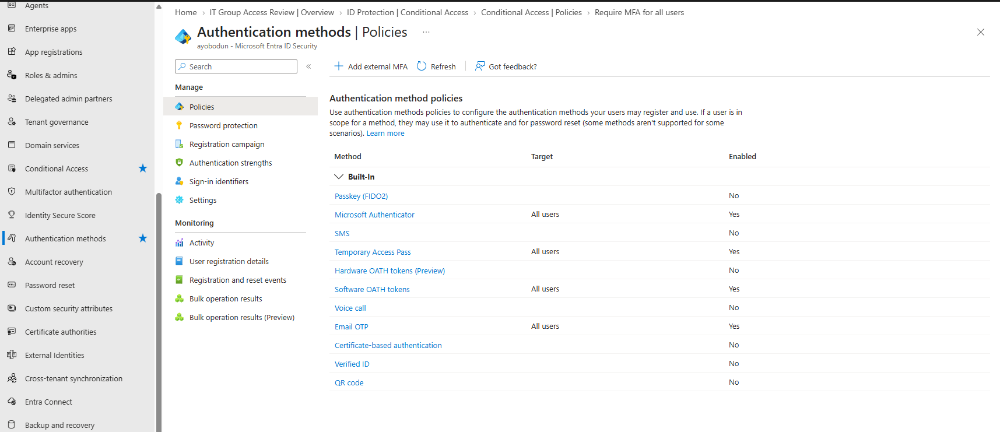
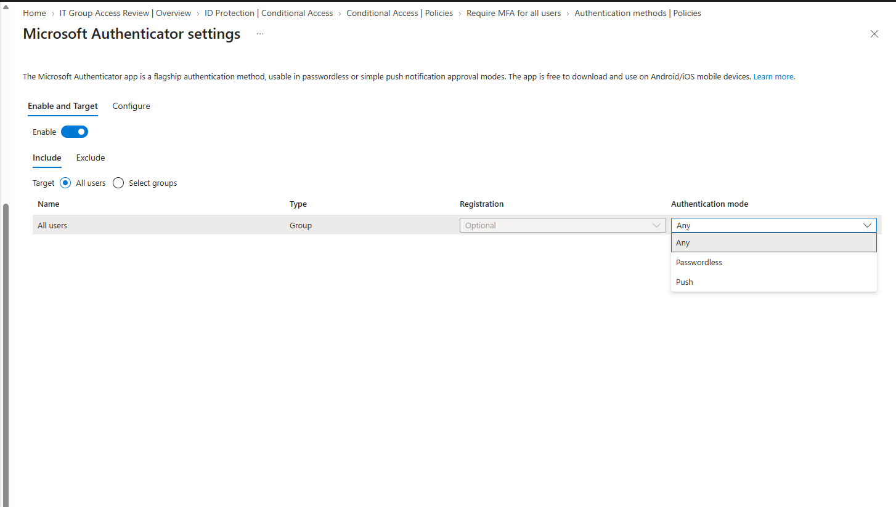
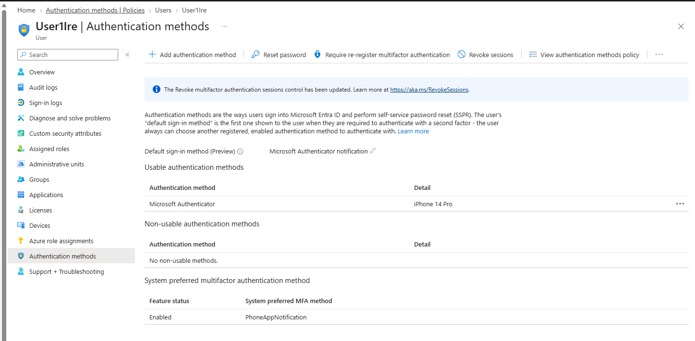
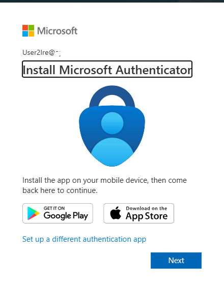
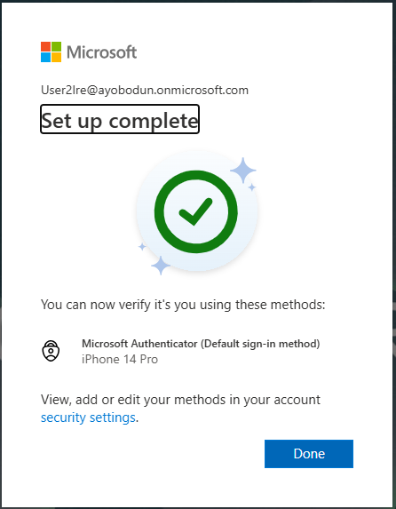
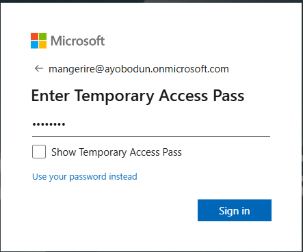
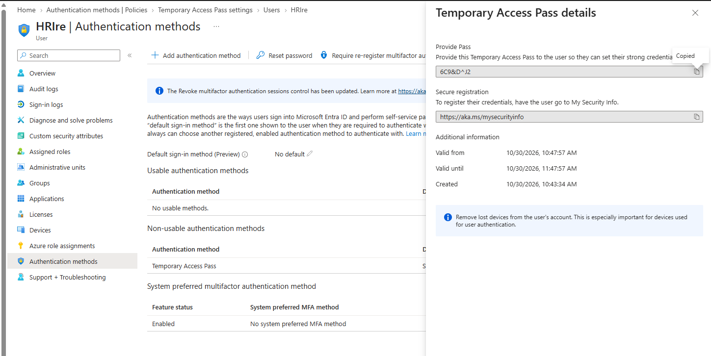

# Microsoft Entra ID – Authentication Methods & Passwordless Authentication

## 🧩 Overview

This lab explores authentication methods in Microsoft Entra ID, focusing on authentication method policies, Microsoft Authenticator, user authentication method management, security information registration, and Temporary Access Pass (TAP).

Authentication methods help organisations secure user identities, support Multi-Factor Authentication (MFA), and provide users with secure ways to authenticate or register additional authentication methods.

In this lab, I explored the authentication methods configuration in Microsoft Entra ID, reviewed the Microsoft Authenticator policy, examined a test user's authentication methods, explored the user-facing security information registration experience, and worked with Temporary Access Pass.

The lab demonstrates how administrators can manage authentication methods and investigate authentication-related activity in Microsoft Entra ID.

## 🎯 Objectives

- Explore authentication method policies in Microsoft Entra ID.
- Review the Microsoft Authenticator authentication method policy.
- Examine authentication methods assigned to a designated test user.
- Understand the user-facing security information registration process.
- Explore Temporary Access Pass (TAP) and its role in authentication method registration.
- Understand how Microsoft Entra sign-in logs can help investigate authentication activity.
- Identify security considerations when managing authentication methods.

## 🛠️ Technologies Used

- Microsoft Entra ID
- Microsoft Authenticator
- Multi-Factor Authentication (MFA)
- Temporary Access Pass (TAP)
- Microsoft Entra Sign-in Logs
- Microsoft Entra Security Info registration

---

## 🧪 Step-by-Step Implementation

### 1. Authentication Methods Dashboard

Navigated to the Microsoft Entra admin centre and opened the Authentication Methods section.

This area allows administrators to review and manage authentication method policies that determine which authentication methods are available to users within the organisation.

I used this page to explore the available authentication methods and understand how authentication policies are managed centrally.

**Screenshot:**

---

### 2. Microsoft Authenticator Policy

Opened the Microsoft Authenticator authentication method policy to review its configuration.

Microsoft Authenticator can support Multi-Factor Authentication and passwordless sign-in, depending on the organisation's configuration and the options enabled for users.

Authentication method policies help administrators control which users can use a particular method and how that method is made available.

This step helped me understand how Microsoft Authenticator is managed through Microsoft Entra ID.

**Screenshot:**

---

### 3. User Authentication Methods

Opened the authentication methods section for a designated test user.

This section allows administrators to review the authentication methods associated with a user and, where permitted, manage or remove methods.

Reviewing a user's authentication methods can help administrators troubleshoot sign-in issues, support users who have lost access to an authentication method, and investigate authentication-related problems.

Access to some actions depends on the administrator's assigned Microsoft Entra role and the organisation's configuration.

**Screenshot:**

---

### 4. Authentication Method Registration

Explored the user-facing security information registration experience.

Users can access their security information to register or manage supported authentication methods, such as Microsoft Authenticator, depending on the methods enabled by their organisation.

This process is important when onboarding users, setting up MFA, or preparing users to authenticate using an additional or passwordless method.

The registration experience also helps demonstrate the difference between an administrator configuring an authentication method policy and an end user registering an authentication method for their account.

**Screenshot:**

---

### 5. Authentication Validation

Reviewed the authentication experience and the available validation evidence for the designated test account.

Microsoft Entra sign-in logs provide information that can help administrators investigate authentication attempts, including whether a sign-in succeeded or failed and details about the authentication requirements and methods involved.

To investigate a sign-in:

1. Open the Microsoft Entra admin centre.
2. Navigate to **Entra ID → Monitoring & health → Sign-in logs**.
3. Filter the logs using the designated test user's account.
4. Select the relevant sign-in event.
5. Open the **Authentication Details** tab.
6. Review the authentication steps, results, and any available additional details.

The information displayed depends on the selected event and the authentication flow. A security information registration event should not automatically be treated as proof that a separate sign-in was successfully validated.

**Screenshot:**

---

### 6. Temporary Access Pass (TAP)

Explored Temporary Access Pass (TAP), a time-limited passcode in Microsoft Entra ID that can help users register authentication methods or recover access to their accounts.

TAP can be particularly useful during onboarding or when a user needs to register an authentication method but cannot initially complete the usual authentication process.

Administrators can configure the TAP authentication method policy and, when authorised, issue a TAP to a designated user.

TAP configuration can include settings such as its lifetime and whether it can be used once or multiple times, depending on the policy configuration.

When using TAP, administrators should ensure that:
- It is issued only to the intended user.
- Its lifetime is appropriate for the use case.
- The code is shared securely.
- The code is not stored in public repositories or exposed in screenshots.
- It is used in accordance with the organisation's identity security procedures.

**Screenshot:**

---

### 7. Temporary Access Pass – User Sign-In Experience

Reviewed the Temporary Access Pass sign-in experience.

A user with a valid TAP may be able to use it to access the relevant authentication experience and register a supported authentication method, subject to the tenant's configuration and Microsoft's authentication requirements.

This process demonstrates how TAP can support initial authentication method registration when a user does not yet have access to their usual authentication method.

The exact experience depends on the configuration of the tenant, the user account, and the authentication method being registered.

**Security note:** Temporary Access Pass codes are sensitive credentials. They must never be included in screenshots committed to a public repository.

**Screenshot:**

---

## 🔐 Security Considerations

Authentication methods are an important part of identity security in Microsoft Entra ID.

Key security considerations include:

- **Least privilege:** Assign only the administrator roles required to manage authentication methods.
- **Multi-Factor Authentication:** Encourage users to register appropriate authentication methods in accordance with organisational policy.
- **Secure registration:** Ensure authentication method registration is completed by the intended user.
- **Temporary Access Pass protection:** Treat TAP as a sensitive, time-limited credential and share it securely.
- **Policy scope:** Enable authentication methods for the appropriate users or groups rather than unnecessarily broadening access.
- **Sign-in monitoring:** Review sign-in logs when investigating authentication issues or suspicious activity.
- **Credential protection:** Never commit passwords, TAP codes, recovery codes, or other credentials to GitHub.
- **Evidence sanitisation:** Remove or obscure personal information, tenant identifiers, IP addresses, and other sensitive details from screenshots before publishing them.

---

## 🔎 Troubleshooting and Validation

During authentication method configuration and testing, administrators may encounter issues caused by permissions, policy settings, user eligibility, or licensing requirements.

Common checks include:

- Confirming that the relevant authentication method is enabled in the tenant's authentication method policy.
- Verifying that the intended user falls within the policy's configured scope.
- Checking that the administrator has the required role to view or manage the user's authentication methods.
- Confirming that a Temporary Access Pass is valid and has not expired or exceeded its permitted usage.
- Reviewing the relevant sign-in event and its Authentication Details when troubleshooting authentication attempts.
- Checking whether the required licence is available for features that depend on additional Microsoft Entra capabilities.

Not every authentication feature requires the same licence or administrator role. Requirements depend on the specific feature and the action being performed.

---

## 📚 Key Learnings

Through this lab, I developed a better understanding of:

- How authentication method policies are managed in Microsoft Entra ID.
- The role of Microsoft Authenticator in MFA and passwordless authentication.
- How administrators can review authentication methods associated with a user.
- The user-facing process for registering security information.
- How Temporary Access Pass can support authentication method registration and account onboarding.
- How sign-in logs help administrators investigate authentication activity.
- Why least privilege, secure credential handling, and appropriate policy scoping are important when managing identity security.

---

## ✅ Final Result

This lab provided practical exposure to Microsoft Entra ID authentication method management, Microsoft Authenticator policy configuration, user authentication method review, security information registration, and Temporary Access Pass.

It also reinforced the importance of validating authentication activity, protecting temporary credentials, and applying appropriate administrative permissions when managing user authentication.

The lab forms part of my Microsoft Entra ID identity and access management learning portfolio, documenting practical work related to authentication methods and identity security.

---
