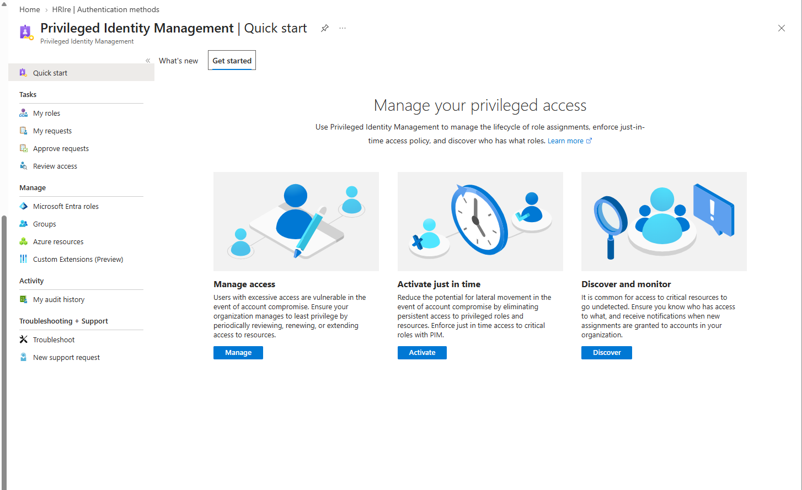
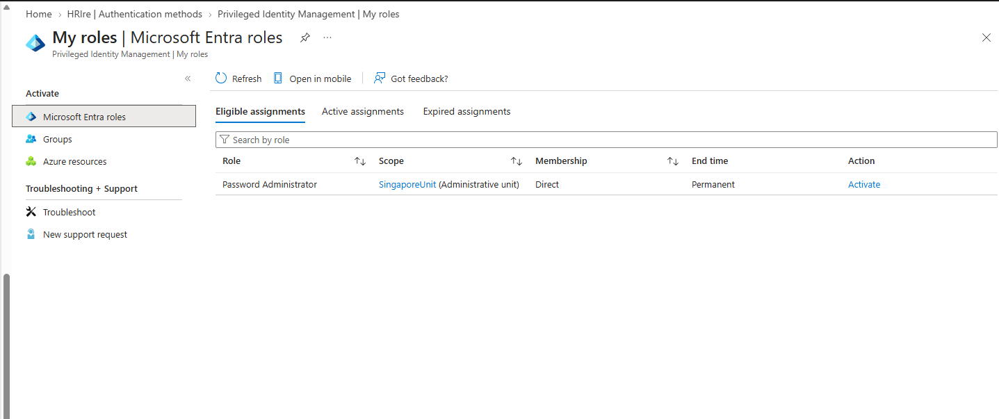
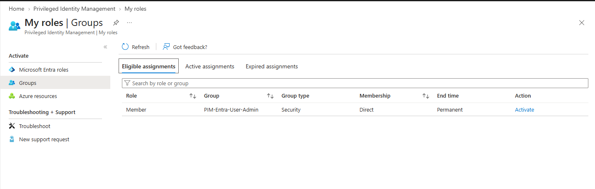
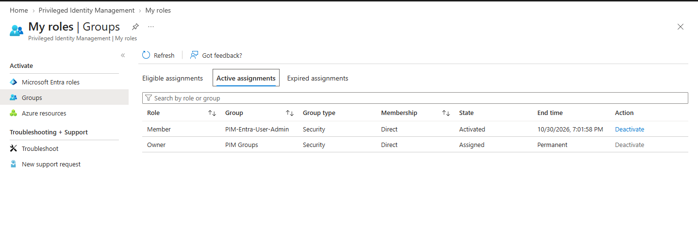
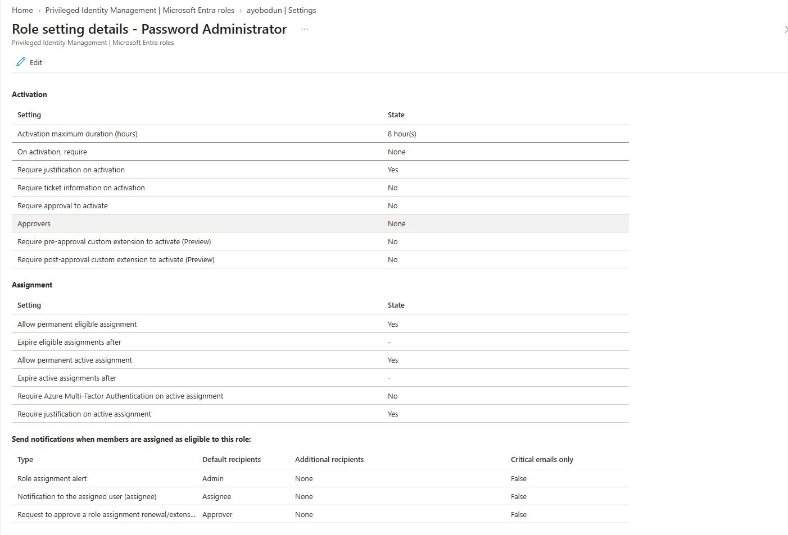
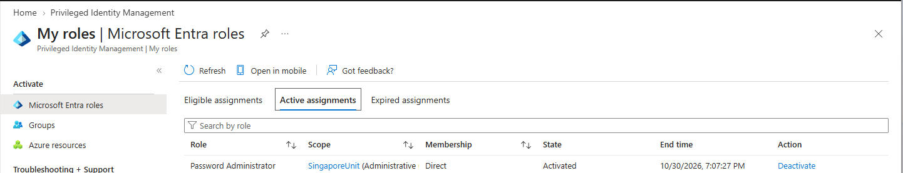
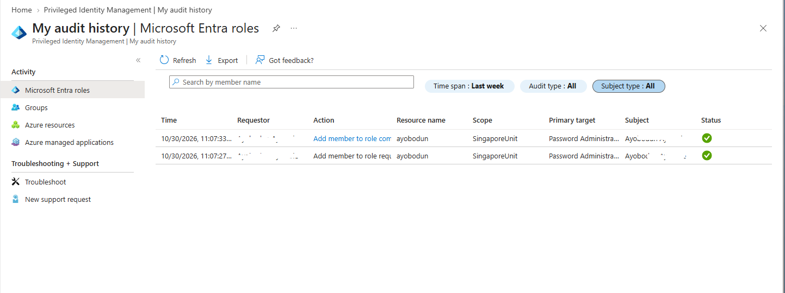

# Microsoft Entra ID – Privileged Identity Management (PIM)

## 📌 Overview

This lab explores Microsoft Entra Privileged Identity Management (PIM), a service that helps organisations manage, control, and monitor privileged access to important resources.

PIM enables organisations to manage privileged role assignments through eligible and active assignments, time-bound access, and activation controls where supported.

The objective of this lab is to understand how PIM can reduce standing administrative privileges and support the principle of least privilege.

---

## 🎯 Real-World Security Risk

Permanent administrative access can expose organisations to significant security risks, including:

- Unauthorised changes to identity and access configurations.
- Privilege escalation following an account compromise.
- Excessive administrative permissions.
- Limited visibility into privileged role activation.
- Increased risk from unused or unnecessary administrator accounts.

PIM helps mitigate these risks by allowing organisations to control privileged access and monitor how administrative roles are assigned and used.

---

## 🛠️ What I Explored

In this lab, I explored privileged role management in Microsoft Entra ID.

The lab covers:

- Reviewing the PIM dashboard.
- Exploring Microsoft Entra roles.
- Understanding eligible and active role assignments.
- Reviewing role activation settings.
- Exploring privileged role activation requirements.
- Understanding how role assignments can be validated.
- Reviewing PIM audit and activation history where available.

---

## 🧪 Environment

- Microsoft Entra ID
- Privileged Identity Management (PIM)
- Microsoft Entra directory roles
- Designated test account, where available
- Microsoft Entra audit logs

---

## 📸 Step-by-Step Evidence

### 1. PIM Dashboard

Opened the Privileged Identity Management area in the Microsoft Entra admin centre and reviewed the available management options.

The PIM dashboard provides an entry point for managing privileged access and reviewing available governance features.

**Screenshot:**

---

### 2. Microsoft Entra Roles

Opened the Microsoft Entra roles section in PIM and reviewed the available directory role management options.

Microsoft Entra roles control access to administrative functions and resources. The roles available for management depend on tenant licensing, configuration, and the permissions of the signed-in administrator.

**Screenshot:**

---

### 3. Eligible Role Assignments

Reviewed the eligible role assignments section to understand how users can be assigned administrative roles that they activate when required.

Eligible assignments support just-in-time access by allowing privileged permissions to be activated when needed rather than remaining permanently active.

**Screenshot:**

---

### 4. Active Role Assignments

Reviewed the active role assignments section and compared it with eligible role assignments.

An active assignment provides the assigned role's privileges while the assignment is active, subject to the role and applicable access controls.

This comparison helps demonstrate the difference between standing administrative access and eligible access that requires activation.

**Screenshot:**

---

### 5. Role Activation Settings

Reviewed the activation settings available for a selected Microsoft Entra role.

Depending on the role, tenant configuration, and available features, activation settings may include:

- Multifactor authentication requirements.
- Justification for activation.
- Ticket or change-request information.
- Approval requirements.
- Maximum activation duration.

These controls help organisations ensure that privileged access is granted according to their security requirements.

**Screenshot:**

---

### 6. Role Activation

Reviewed the role activation experience for an eligible assignment, where available.

The activation process may require the user to satisfy configured requirements before privileged permissions become active.

This step helps demonstrate how eligible role assignments can support controlled, just-in-time administrative access.

**Screenshot:**

---

### 7. Role Assignment Validation

Reviewed the role assignment information to understand how administrators can verify its status and duration.

Validation can include checking whether an assignment is eligible or active, confirming the assigned role, and reviewing the relevant activation period.

Where role activation was completed, the resulting assignment status can be used to help confirm that the activation behaved as expected.

**Screenshot:**

---

### 8. PIM Audit and Activation History

Reviewed the available PIM history and audit information to understand how privileged role assignments and activation events can be investigated.

Audit information can help administrators investigate unexpected privileged access, review administrative activity, and support security assessments.

The available records depend on the actions performed, tenant configuration, and the audit information accessible to the administrator.

**Screenshot:**

---

## 🔐 Security Considerations

Key security considerations associated with privileged identity management include:

- Prefer eligible assignments over permanently active assignments where appropriate.
- Apply the principle of least privilege.
- Require multifactor authentication for privileged role activation where supported and appropriate.
- Configure approval and justification requirements according to organisational risk.
- Use time-limited role assignments and activation durations where possible.
- Review privileged role assignments regularly.
- Monitor activation history and audit events.
- Avoid unnecessary permanent assignments to highly privileged roles.
- Use designated test accounts and follow change-management procedures.

Highly privileged roles should only be assigned or activated when authorised and necessary. Testing should be performed in a controlled environment using the minimum permissions required.

---

## 🧰 Tools & Services Used

- Microsoft Entra admin centre
- Microsoft Entra Privileged Identity Management (PIM)
- Microsoft Entra directory roles
- Microsoft Entra audit logs
- Multifactor authentication (MFA)

---

## 📈 Key Learnings

This lab developed my understanding of:

- How Microsoft Entra PIM supports privileged access management.
- The differences between eligible and active role assignments.
- How just-in-time access can reduce standing administrative privileges.
- The purpose of role activation settings.
- How privileged role assignments can be reviewed and validated.
- How audit information supports privileged access investigations.
- Why least privilege and regular access reviews are important for identity security.

---

## 🧠 Troubleshooting Notes

### PIM Is Not Available

- Check whether the tenant has the required licensing.
- Confirm that the signed-in administrator has sufficient permissions.
- Verify that the correct Microsoft Entra tenant is selected.
- Review the PIM options available in the admin centre.

### Unable to Assign a Role

- Confirm that the administrator has the necessary permissions.
- Check the role assignment requirements.
- Verify that the target user or group is eligible for the assignment.
- Review applicable licensing and tenant restrictions.

### Unable to Activate an Eligible Role

- Confirm that an eligible assignment exists.
- Check whether MFA, justification, approval, or other activation requirements must be satisfied.
- Review the assignment's validity period.
- Check whether the assignment has expired or the activation request was denied.

### Role Activation Does Not Appear as Expected

- Refresh the role assignment view.
- Confirm whether activation completed successfully.
- Review PIM history and available audit information.
- Verify that the expected role and account were used.

---

## 🏁 Lab Result

This lab documents an exploration of Microsoft Entra Privileged Identity Management, including directory role management, eligible and active assignments, activation settings, role assignment validation, and audit history.

It reinforces how PIM can support just-in-time privileged access, reduce unnecessary standing administrative privileges, and improve visibility into administrative access.

**Validation status:** The screenshots document the sections explored. Any role assignment, configuration change, or successful activation should only be reported as completed when it has been verified in the tenant.
