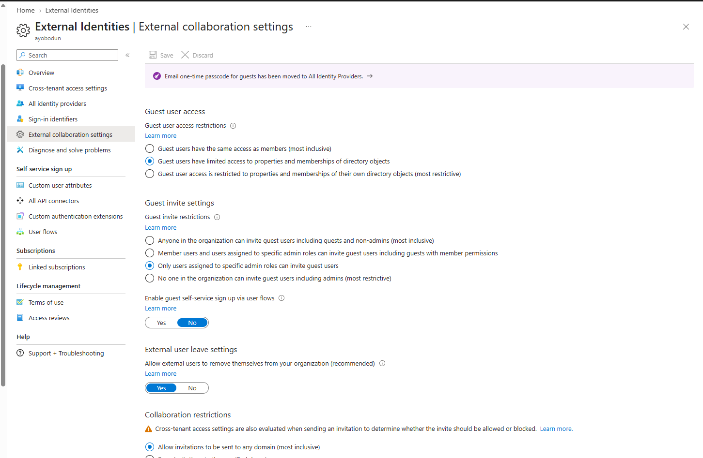
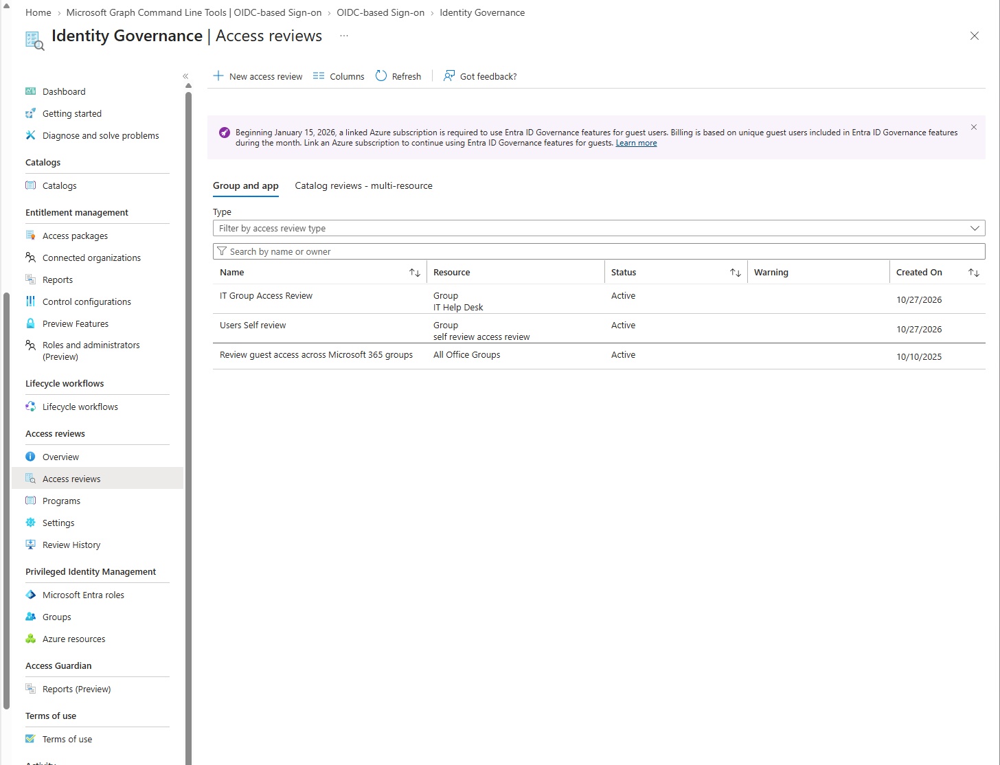
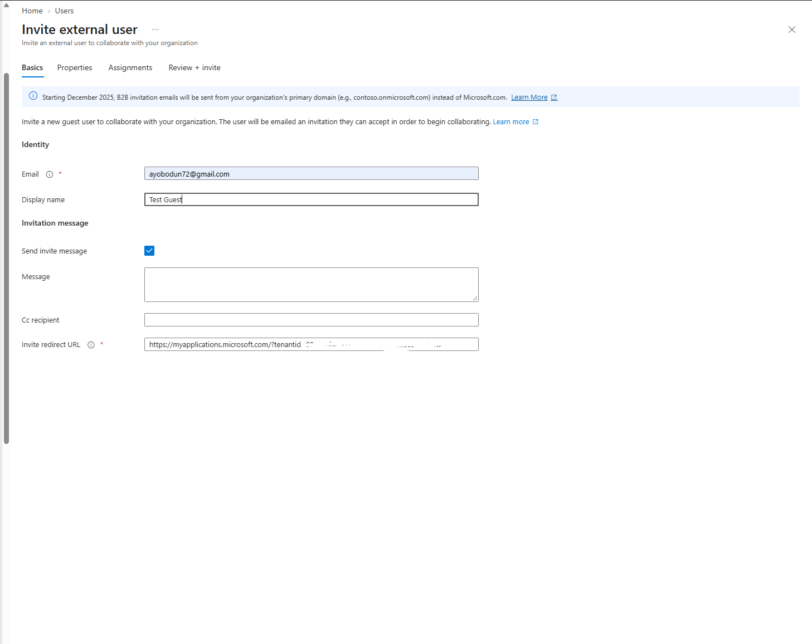
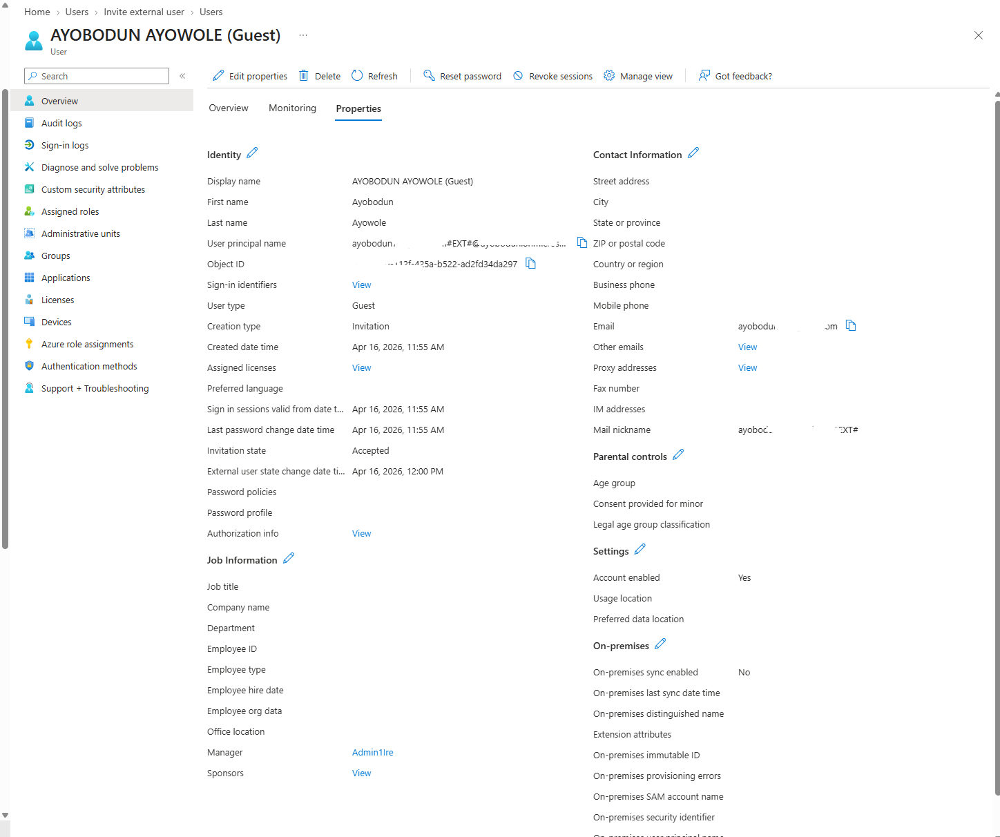
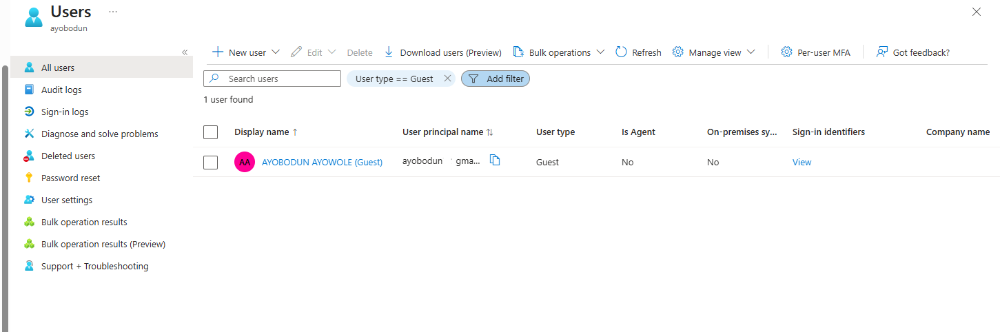

# Microsoft Entra ID – Guest Identities & External Collaboration

## 📌 Overview

This lab explores guest identity management and external collaboration in Microsoft Entra ID.

Microsoft Entra B2B collaboration allows organisations to work securely with external users, including contractors, suppliers, consultants, and business partners, by providing access to selected organisational resources.

The objective of this lab was to understand how guest users are invited, managed, and governed while maintaining appropriate security controls over external access.

---

## 🎯 Real-World Security Risk

Poorly managed guest identities can introduce security risks, including:

- External users retaining access after a project or contract ends.
- Guest accounts having excessive permissions.
- Unauthorised external collaboration.
- Sensitive organisational information being shared with unintended users.
- Limited visibility into guest account activity.
- Inactive guest accounts remaining in the directory indefinitely.

Microsoft Entra ID provides controls that help organisations manage external identities and restrict access to appropriate resources.

---

## 🛠️ What I Explored

In this lab, I explored guest identity management and external collaboration in Microsoft Entra ID.

The lab covered:

- Reviewing guest users in the Microsoft Entra admin centre.
- Exploring external collaboration settings.
- Understanding Microsoft Entra B2B collaboration.
- Exploring the guest invitation process.
- Reviewing guest user properties.
- Understanding guest group membership and resource access.
- Exploring access reviews for guest users where available.
- Understanding guest account lifecycle management.
- Reviewing security considerations for external collaboration.

---

## 🧪 Environment

- Microsoft Entra ID
- Microsoft Entra External Identities
- Microsoft Entra B2B collaboration
- Microsoft Entra users and groups
- Microsoft Entra admin centre
- Access reviews, where available

---

## 📸 Step-by-Step Evidence

### 1. External Collaboration Settings

Reviewed the external collaboration settings in Microsoft Entra ID.

These settings help administrators control how external users collaborate with an organisation and who is permitted to invite guest users.

Depending on the tenant configuration, administrators may be able to manage guest invitation permissions and restrictions on external collaboration.

Restricting guest invitations to authorised users can help reduce the risk of unauthorised external access.

**Screenshot:**

---

### 2. Guest Access Review

Explored the access review functionality available in Microsoft Entra ID.

Access reviews help organisations periodically evaluate whether users should retain access to groups, applications, and other supported resources.

For external collaboration, access reviews can help determine whether guest users still require access after a project ends or their business responsibilities change.

The available functionality depends on tenant licensing, configuration, and administrator permissions.

**Screenshot:**

---

### 3. Guest User Invitation

Reviewed the guest user invitation process in Microsoft Entra ID.

Microsoft Entra B2B collaboration allows an organisation to invite an external user into its directory so that the user can collaborate with internal users and access permitted resources.

Guest invitations should be issued only when there is a legitimate business requirement. Administrators should also verify that the intended external identity is being invited.

**Screenshot:**

---

### 4. Guest User Properties

Opened a guest user account and reviewed its directory properties.

Microsoft Entra ID distinguishes guest users from member users through the account's user type and other directory attributes.

Reviewing guest user properties helps administrators identify external identities and understand how they are represented within the organisation's directory.

**Screenshot:**

---

### 5. Guest Users Dashboard

Reviewed the users list in Microsoft Entra ID to understand how guest accounts appear alongside other directory users.

The users list provides administrators with a central location to identify guest accounts and access their properties.

Regular reviews of guest accounts can help organisations identify external identities that may no longer require access.

**Screenshot:**

---

## 👥 Guest Group Membership and Resource Access

Guest users may be assigned to groups or granted access to specific applications and resources when required.

Group membership can simplify access management by allowing permissions to be assigned to a group rather than individually to every user.

However, guest users should only receive the permissions required for their responsibilities. Administrators should review group memberships and resource assignments to identify unnecessary access.

In a production environment, guest access should be reviewed whenever a user's responsibilities change or their engagement with the organisation ends.

---

## 🔄 Guest Account Lifecycle Management

Guest identity lifecycle management involves managing external users throughout their relationship with an organisation.

Important lifecycle considerations include:

- **Invitation:** Invite external users only when there is a valid business requirement.
- **Onboarding:** Ensure guest users receive only the access needed for their responsibilities.
- **Access review:** Periodically evaluate whether guest users still require access to organisational resources.
- **Access changes:** Update group memberships and permissions when responsibilities change.
- **Offboarding:** Remove or disable access when a guest's engagement ends, following organisational procedures.
- **Ongoing governance:** Maintain appropriate records and review external identities regularly.

Access reviews and account removal are related but different controls. An access review helps determine whether access should continue, while disabling or deleting an account is a separate administrative action.

Automated identity lifecycle processes may require additional Microsoft Entra capabilities and licensing. This lab focuses on understanding the available guest identity management and governance controls rather than claiming that automated lifecycle workflows were implemented.

---

## 🔐 Security Validation

The following security considerations are important when managing guest identities:

- Restrict guest invitations to authorised users where appropriate.
- Apply the principle of least privilege.
- Review external collaboration settings regularly.
- Monitor guest account activity where appropriate.
- Use access reviews to evaluate whether guest access remains necessary.
- Review group memberships and application permissions.
- Remove or disable access when the business requirement ends.
- Avoid granting guest users unnecessary directory roles.
- Apply appropriate controls before sharing sensitive organisational resources.
- Test configuration changes before applying them broadly.

---

## 🧰 Tools & Services Used

- Microsoft Entra admin centre
- Microsoft Entra External Identities
- Microsoft Entra B2B collaboration
- Microsoft Entra users and groups
- Microsoft Entra access reviews

---

## 📈 Key Learnings

This lab developed my understanding of:

- How Microsoft Entra B2B collaboration supports external users.
- How guest identities are represented in Microsoft Entra ID.
- How external collaboration settings influence guest invitations.
- Why guest users should receive only the permissions they require.
- How groups can help manage access to organisational resources.
- How access reviews support external identity governance.
- Why guest accounts should be reviewed throughout their lifecycle.
- The importance of removing access when an external user's business requirement ends.

---

## 🧠 Troubleshooting Notes

### Unable to Invite a Guest User

- Confirm that the signed-in administrator has the necessary permissions.
- Review the external collaboration settings.
- Check whether guest invitations are restricted.
- Verify that the invitation process is supported by the tenant configuration.

### Guest User Cannot Access a Resource

- Confirm that the guest invitation has been accepted where required.
- Check the guest user's group memberships.
- Review the permissions assigned to the resource.
- Check applicable Conditional Access policies.
- Review sign-in logs for additional information.

### Guest User Has Excessive Access

- Review group memberships and assigned permissions.
- Check for unnecessary directory role assignments.
- Remove permissions that are no longer required, following the appropriate approval process.
- Confirm that the changes have taken effect.

### Guest Account Is No Longer Required

- Confirm that the guest's business engagement has ended.
- Review access to applications, groups, and resources.
- Disable or remove access in accordance with organisational procedures.
- Retain any records required by organisational policy.

---

## 🏁 Lab Result

This lab documents my exploration of Microsoft Entra guest identities and external collaboration, including guest invitation settings, guest user properties, access reviews, and guest account management.

It reinforced the importance of restricting external invitations, applying least privilege, reviewing permissions, and managing guest identities throughout their relationship with an organisation.

The lab forms part of my Microsoft Entra ID identity and access management portfolio.

---
